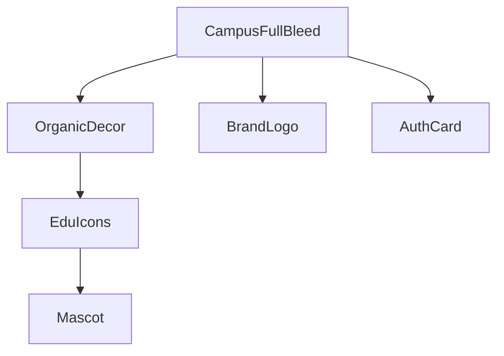

# ORGANIC_SHAPE_DIRECTION — Layout and brand art

Date: 2026-11-20  
Updated: 2026-11-20 (full-screen campus + floating icons)  
Related: [UI_DESIGN_SYSTEM.md](UI_DESIGN_SYSTEM.md) · [RESPONSIVE_GUIDELINES.md](RESPONSIVE_GUIDELINES.md) · [COMPONENT_ARCHITECTURE.md](COMPONENT_ARCHITECTURE.md)

## 1. Goal

One shared learning space: **full-screen campus background**, centered brand character,
floating educational icons, and a **white Clay auth card** floating on the right — not a
hard two-panel split with separate backgrounds.

## 2. Locked direction (owner update)

| Previous | Now locked |
| --- | --- |
| Organic Split with campus only on left column | **Full-screen campus** (`body.auth-page`) |
| Solid / veiled right panel beside the card | **Transparent right stage** — only the white card |
| Mascot alone on left | Mascot + **floating educational icon tiles** |
| Brand mostly SR-hidden | **Logo + slogan** top-left |

Taste (design-taste-frontend): one composition, no emoji structural icons, no sticker clutter,
calm motion, card readable without a second painted wall.

ui-ux-pro-max: Soft/Clay rounded tiles; form contrast via opaque white card (≥4.5:1 text);
decorative layers `aria-hidden`.

## 3. Layer architecture

| Layer | Role | Hook |
| --- | --- | --- |
| 1 | Full-screen campus BG | `body.auth-page` `background-image` cover/center |
| 2 | Organic blobs / trails / sparkles | `.auth-decor` |
| 3 | Educational icon tiles | `.auth-edu-icons` |
| 4 | Main character (IMAGE 2 alpha) | `.auth-mascot` |
| 5 | Logo + slogan | `.auth-brand` |
| 6 | Auth card | `.auth-card` |
| 7 | Interactive form controls | fields inside `.auth-card` |

Do not flatten layers into one baked PNG.

## 4. Spatial composition (desktop)

- **Book** — above-left of character  
- **Headphones** — above character  
- **Chat** — outer left  
- **Analytics** — right of character (clear of form)  
- **ABC / Dictionary** — lower accents near pencil, not on faces  
- **Sparkles / trails / soft circles** — between tiles, low contrast  
- **Organic blobs** — behind character only  

Never cover face, Tico, book, or the auth card.

## 5. Auth card

- White Clay surface, soft shadow, large radius  
- Floats on campus; **no solid right-column fill**  
- Optional *very light* local scrim under the card only if contrast fails QA  
- Contracts unchanged (Login/Register/OAuth)

## 6. Branding

- Logo: `~/brand/logo/tct-english-logo.svg`  
- Slogan: “Learn English. Grow Further.”  
- Top-left; not overlapping mascot face or form  

## 7. Assets

- BG: `auth-campus-bg.jpg` / `.webp` (IMAGE 1) — do not redraw  
- Character: `auth-mascot-pencil.png` alpha (IMAGE 2) — `object-fit: contain`  
- Icons: Font Awesome glyphs inside soft pastel clay tiles (no emoji as primary art)

## 8. Next

Responsive rules: [RESPONSIVE_GUIDELINES.md](RESPONSIVE_GUIDELINES.md).  
Build tasks: [IMPLEMENTATION_PLAN.md](IMPLEMENTATION_PLAN.md).
