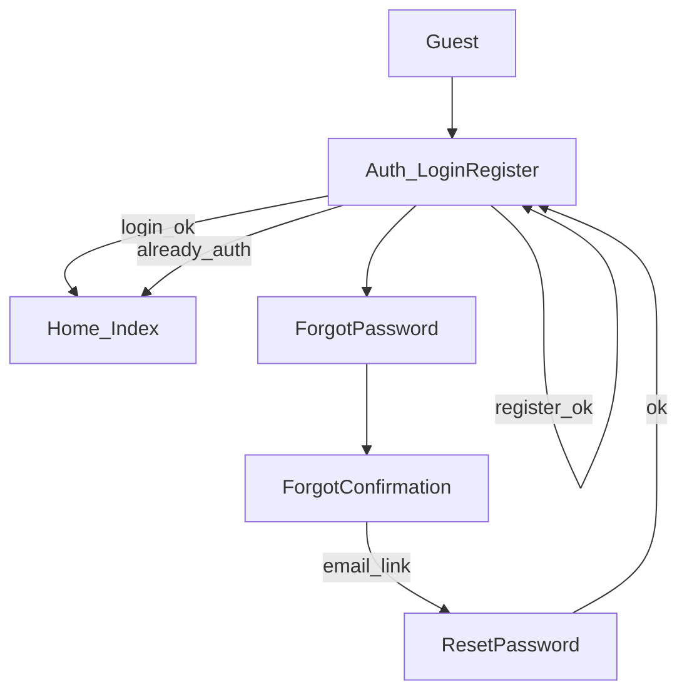

# USER_FLOW — Authentication journeys

Date: 2026-11-20  
Contracts: [BUSINESS_FLOW.md](BUSINESS_FLOW.md)  
UX rules: [UX_PRINCIPLES.md](UX_PRINCIPLES.md)

Each flow lists: start → user actions → system → checks → success / fail → next.

---

## A. Authentication user flow (overview)

| | |
| --- | --- |
| Start | Unauthenticated user needs an account session |
| Actions | Choose Login, Register, OAuth, or Forgot Password |
| System | Cookie auth + optional email reset |
| Success | Authenticated session → learning Home |
| Fail | Stay on Auth/recovery with recoverable errors |

---

## B. Login flow

| Step | Detail |
| --- | --- |
| Start | `/Account/Login` or switch to Login tab |
| Actions | Enter email + password; optional show password; submit; or Google/Facebook |
| System | POST Login JSON; verify user/hash; block check; sign-in |
| Checks | Email/password present; hash verify; not anonymized; not actively blocked |
| Success | `{ success: true }` → loader → `/Home` |
| Fail | Inline error message; or blocked UI + complaint link |
| Next | Retry, Forgot Password, Register tab, or OAuth |

---

## C. Register flow

| Step | Detail |
| --- | --- |
| Start | `/Account/Register` or Register tab |
| Actions | Email, display name, CEFR level, password, accept terms; submit |
| System | Validate; uniqueness; hash; insert user |
| Checks | Required fields; email format; password ≥ 6; email unused |
| Success | Redirect Login + success TempData (Swal) |
| Fail | Same Auth page, Register tab, `ViewBag.ErrorMessage`; fields should retain where browser allows |
| Next | Login with new credentials |

**Note:** No confirm-password step in product contract.

---

## D. Forgot Password flow

| Step | Detail |
| --- | --- |
| Start | Link “Quên mật khẩu?” from Login |
| Actions | Enter email; submit |
| System | If user exists, set 15-minute token and send email; always show confirmation |
| Checks | Model validation (email format) |
| Success | Confirmation page with generic message |
| Fail | Validation errors on form (not “email not found”) |
| Next | Check inbox; return to Login |

---

## E. Reset Password flow

| Step | Detail |
| --- | --- |
| Start | Link from email → `/Account/ResetPassword?token&email` |
| Actions | New password + confirm; submit |
| System | Validate token/expiry; update hash; clear token |
| Checks | ModelState; token match; expiry > UTC now |
| Success | TempData → Login |
| Fail | Invalid/expired token messages; mismatch confirm |
| Next | Login with new password; or request Forgot again if expired |

---

## F. Error recovery flow

| Error | User sees | Recovery |
| --- | --- | --- |
| Empty / invalid Register fields | Alert on Auth | Fix fields; resubmit |
| Duplicate email | Alert | Use Login or different email |
| Wrong Login credentials | `#login-error-msg` | Retry / Forgot |
| Blocked account | Alert + modal | Wait until unlock / Contact complaint |
| OAuth fail | Return Login | Retry provider or email login |
| Reset token expired | Field/token error | Forgot Password again |
| Loader timeout | Recovery buttons on overlay | Retry navigate / cancel |

Preserve typed values when the failure does not require a clean slate.

---

## G. Navigation flow between pages

| From | To | Control |
| --- | --- | --- |
| Login tab | Register tab | Tab / footer link |
| Register tab | Login tab | Tab / footer link |
| Login | Forgot Password | “Quên mật khẩu?” |
| Forgot / Confirmation / Reset | Login | Back / success redirect |
| Auth | Previous page | Close/back button (`history.back`) |
| Auth | Home | Only after successful auth |
| Any Auth GET while signed in | Home | Controller redirect |

---

## H. Already authenticated

| Start | Any GET Login or Register |
| --- | --- |
| System | `User.Identity.IsAuthenticated` → redirect Home |
| UI | Do not show Auth forms to signed-in users |

---

## I. Not authenticated

| Start | Protected learner/admin routes or explicit Auth URLs |
| --- | --- |
| System | Challenge / redirect to Login as configured elsewhere |
| UI | Auth Organic Split is the guest entry surface |

---

## J. Session or token expiry

| Case | Behavior |
| --- | --- |
| Cookie session ends | User is guest again; Login required |
| Reset token > 15 minutes | Reset POST fails with expired message |
| Concurrent reset | Only one `ExecuteUpdate` wins; loser sees invalid token |

UI copy should explain “request a new link” without exposing whether an email exists on Forgot.

---

## Design implications (pointer)

Layout and component mapping for these journeys: [ORGANIC_SHAPE_DIRECTION.md](ORGANIC_SHAPE_DIRECTION.md),
[COMPONENT_ARCHITECTURE.md](COMPONENT_ARCHITECTURE.md).
