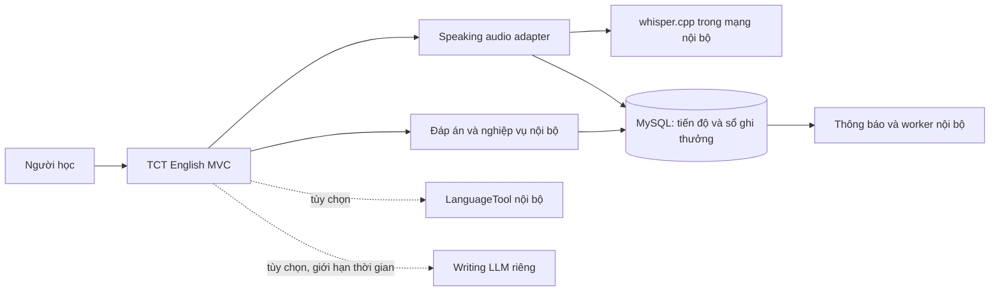

# Khảo sát chức năng học của Nguyễn Bảo Châu và phương án giảm phụ thuộc API

Khảo sát bắt đầu **29/10/2026**, hoàn thiện tài liệu **30/10/2026** (UTC+7). Trạng thái: **đã phân tích source và chạy kiểm thử nền; chưa nâng cấp ứng dụng**. Tên file giữ ngày bắt đầu để các liên kết handoff nhất quán.

Tài liệu đi kèm:

- [Plan theo từng lô](../superpowers/plans/2026-10-29-bao-chau-learning-reliability-plan.md).
- [Prompt thực thi bằng Cursor](../../.ai/prompts/cursor-grok-bao-chau-learning-upgrade.md).

## 1. Phạm vi và mức độ bằng chứng

Phạm vi theo yêu cầu hiện tại là chức năng người học: Speaking video/shadowing/dictation, Speaking theo bộ thẻ, Writing, Goals và Notifications. Notifications được đưa vào theo yêu cầu lần này; tài liệu không khẳng định mọi dòng code của module đó đều do Châu viết.

Loại trừ Auth/Profile/Settings, Contact, AI Chat/embed, toàn bộ Admin, Billing, Vocabulary/Set/Folder, Class/Chat, Reading và Listening của đồng đội. Chỉ đọc các caller ngoài phạm vi để đánh giá ảnh hưởng. Không thay đổi giao diện thẩm mỹ trong dự án nâng cấp chức năng này.

Baseline Git: HEAD `3d27a68c8468207eca5a11653c72e735117fc637`, nhánh đang mở `feature/bao-chau-ui-audit`. Khi bắt đầu đã có **19 file source/CSS sửa chưa commit**, cùng tài liệu UI chưa track. Khảo sát giữ nguyên chúng. Các thay đổi đang làm bằng Antigravity phải được phối hợp trước khi Cursor đụng cùng view.

Đã dùng CodeGraph trước khi khám phá source; đọc có giới hạn các phần bị lược bỏ, Razor/JS và cấu hình không được trả đầy đủ. Không index/sync lại. Không chạy ứng dụng thường vì startup có seeder ghi DB (BUG-008). Không gọi Gemini, dùng key thật, nhập video thật hay ghi âm của người dùng.

Mức bằng chứng trong báo cáo:

- **Source xác nhận**: nhánh điều khiển/thuật toán nhìn thấy trực tiếp trong code hiện tại.
- **Rủi ro từ source**: có điều kiện lỗi hợp lý nhưng chưa tái hiện trên DB triển khai hoặc trình duyệt.
- **Đã kiểm thử**: chỉ những kiểm tra ghi ở mục 7.
- Không có log vận hành đã ẩn thông tin nhạy cảm, thông số máy chủ hoặc benchmark nhận giọng nói. Vì vậy **chưa kết luận vì sao key cụ thể của Châu bị ngắt**. 401/403, 429, timeout và lỗi mạng cần được phân loại riêng; thay key không phải biện pháp sửa chung.

## 2. Nền tảng thật và danh mục luồng

`TCTEnglish/TCTEnglish.csproj` và project test đều target **net9.0**, EF Core **9.0.4**, Razor/Bootstrap/JavaScript. Source `Program.cs:28` dùng **UseMySql/Pomelo**, `.csproj` có `Pomelo.EntityFrameworkCore.MySql 9.0.0`. Không lập migration SQL Server theo mô tả cũ trong AGENTS. Không nâng framework trong phạm vi này.

| Luồng | View/cổng vào | Source xử lý và dữ liệu |
| --- | --- | --- |
| Danh mục Speaking | `Views/Speaking/Index.cshtml`, `/Speaking` | `SpeakingController`, `SpeakingService`, playlist/video, quyền nội dung riêng |
| Luyện video | `Views/Speaking/Practice.cshtml`, `/Speaking/Practice/{id}` | `wwwroot/js/speaking.js`, câu có timecode, tiến độ/hoàn thành video |
| Import video cá nhân | POST `/Speaking/My/Create` | `SpeakingService.CreateOwnedVideoAsync`, Premium/Admin, `IYoutubeTranscriptService` |
| Nói theo bộ thẻ | `Views/Study/Speaking.cshtml`, `/Home/Speaking/{id}` | `StudyController.Speaking`, `IStudyService`; phụ thuộc dữ liệu bộ thẻ của đồng đội, không đổi quyền/sở hữu bộ thẻ |
| Duyệt Writing | `Views/Study/Writing.cshtml`, `WritingExercises.cshtml` | `/Home/Writing`, `/Home/Writing/Exercises` và `/Data`; `WritingService` |
| Luyện Writing | `Views/Study/WritingPractice.cshtml` | `/Home/Writing/Practice`, `/Data`, `/Hint`, POST `/Evaluate`; lưu attempt/progress |
| Tạo bài Writing | POST `/Home/Writing/Exercises/CreateFromAi` | `WritingService.Generation.cs`, quyền Premium/Admin, quota và replay cache |
| Goals | `Views/Goals/Index.cshtml`, `/Goals`, POST `/Goals/UpdateGoal` | `GoalsService`, `StreakService`, daily activity/XP/badges |
| Thông báo | `Views/Notification/Index.cshtml`, chuông dùng chung | `NotificationController`, `NotificationService`, `NotificationWorker`, `notifications.js` |

Trong source hiện tại, Goals nhận tín hiệu của **cả năm** lĩnh vực Vocabulary/Speaking/Writing/Reading/Listening. Backlog cũ còn ghi Reading/Listening deferred. Không dùng thông tin cũ để tắt hai lĩnh vực của đồng đội.

## 3. Bản đồ phụ thuộc bên ngoài

| Phần | Phụ thuộc hiện tại | Điều vẫn hoạt động khi mất phụ thuộc |
| --- | --- | --- |
| Phát video Speaking | YouTube iframe API, video/thumbnails trên YouTube | Dữ liệu bài/câu đã lưu; phát video vẫn cần YouTube |
| Nhận giọng nói | `SpeechRecognition/webkitSpeechRecognition` trong JS và view bộ thẻ | Dictation gõ, xem câu; khả năng ghi/so sánh bản thu cần bổ sung |
| Import transcript | YouTube captions qua YoutubeExplode, sau đó Gemini nếu caption không dùng được | Bài đã lưu không cần tạo transcript lại mỗi lượt học |
| Writing chấm câu | `WritingAiEvaluationService` gọi `IAiProviderClient`; DI hiện trỏ Gemini | Đã có bộ rule-based, nhưng thường phải đợi AI thất bại mới dùng |
| Writing tạo bài | Gemini tạo nội dung và bản dịch song ngữ | Học các bài có sẵn; không thể thay sinh bản dịch bằng việc tách câu đơn thuần |
| Goals/Notifications | DB nội bộ và BackgroundService | Không cần key AI cho nghiệp vụ chính |

Không cần key không đồng nghĩa offline: một số trình duyệt gửi audio Web Speech ra máy chủ nhận dạng. Tài liệu [MDN SpeechRecognition](https://developer.mozilla.org/en-US/docs/Web/API/SpeechRecognition) nêu rõ hạn chế này. Máy người học gửi audio tới **máy chủ của nhóm** cũng không đồng nghĩa audio luôn ở trên thiết bị; phải mô tả đúng nơi xử lý.

## 4. Phát hiện và đề xuất theo mức ưu tiên

Mốc dòng là điểm định vị tại lúc khảo sát; Cursor phải kiểm tra lại khi source đã thay đổi.

| ID | Ưu tiên / bằng chứng | Phát hiện và tác động | Hướng giải quyết / lô |
| --- | --- | --- | --- |
| S01 | P0, source xác nhận | `speaking.js:402,599,641`: thiếu SpeechRecognition đi vào demo; điểm 78–97 ngẫu nhiên được POST lưu thật. Các điểm accuracy/fluency/completeness của nhánh nhận dạng cũng cộng nhiễu ngẫu nhiên. Có thể làm tăng completion/XP mà không phản ánh bài nói. | Bỏ demo lưu thật, bỏ điểm bịa; tách text-match khỏi đánh giá phát âm. L1 rồi L4. |
| S02 | P0, source xác nhận | `SpeakingController.SaveSpeakingProgress:118`: nhận bốn điểm từ client, kiểm tra khoảng rồi upsert/cộng thưởng. Có CSRF và kiểm tra quyền; chúng không chứng minh điểm đã được chấm. | Chấm audio phía server, kết quả gắn user/câu, client không được tự cấp điểm. L4. L1 chưa giải quyết xong lỗ hổng này. |
| S03 | P1, source + tài liệu API | Web Speech có độ tương thích/mạng phụ thuộc trình duyệt; edit distance trên transcript không đo phoneme/prosody. | Ghi âm thật, nghe đối chiếu luôn sẵn; thử ASR do nhóm vận hành, nhãn kết quả là mức khớp lời nói. L4. |
| S04 | P1, source xác nhận | `YoutubeTranscriptService:272–347,392–429`: tải toàn bộ audio vào RAM, base64, gọi Gemini tối đa 5 phút; timecode chia theo tỷ lệ số từ, không căn audio thực. Có thể làm A–B loop lệch dù transcript đọc có vẻ đúng. | Caption có timecode trước; import transcript hợp lệ; ASR có timestamp thật khi được bật. Không tạo timecode bằng tỷ lệ từ. L5. |
| W01 | P1, source xác nhận | `WritingService.EvaluateWritingSentenceAsync:178–192` gọi AI cho mọi trường hợp không hard-fail, kể cả có đáp án tham chiếu. `GeminiProviderClient:46–93` có retry theo từng timeout; mặc định options cho phép 3 lần thử, mỗi lần 30 giây, cộng backoff. Đây là khả năng từ mặc định, chưa phải độ trễ đo thực tế. | Mặc định core chấm nội bộ; AI là tùy chọn có ngân sách thời gian riêng và không cản lưu bài. Truyền cancellation xuyên suốt. L2. |
| W02 | P1, source xác nhận | `WritingService:1364–1388`: fallback cho qua với coverage từ khóa >=0.4, length ratio 0.45–2.5; không đủ để chứng minh nghĩa đúng, dễ bỏ qua phủ định/đảo vai. | Bộ đáp án được kiểm soát + trạng thái needs-review; grammar chỉ góp ý ngữ pháp. Không dùng LanguageTool làm bộ chấm nghĩa tiếng Việt–Anh. L2/L7. |
| W03 | P2, source/rủi ro | Tạo bài đã có quota 5/ngày, fingerprint/replay 5 phút, lock theo user trong tiến trình (`WritingService.Generation.cs`). Chúng không phải idempotency bền vững qua restart/nhiều instance. | Giữ sinh bài là tiện ích tùy chọn, lỗi nhanh có thông báo; nâng idempotency khi triển khai nhiều instance. Local LLM chỉ thử sau đo chất lượng/hạ tầng. L7. |
| G01 | P1, rủi ro từ source | Speaking cập nhật completion rồi mới `RecordLearningActivityAsync`; Writing lưu attempt/progress rồi mới gọi Goals (`WritingService:195–210,1027`). Nếu tiến trình/DB lỗi ở khoảng giữa, completion có thể đã lưu nhưng reward chưa ghi; replay không nhất thiết phục hồi do không còn first-completion. | Regression fault-injection và credit ledger/transaction cho Speaking+Writing. Các test replay hiện có không chứng minh chịu được crash. L6. |
| N01 | P1, source xác nhận | Goals dùng `BusinessDateHelper` UTC+7; `NotificationService:150,359` dùng UTC date. Từ 00:00 đến trước 07:00 Việt Nam có thể tìm sai daily activity hoặc dedup sai ngày. | Một clock kiểm thử được; business-date và khoảng UTC đầu/cuối ngày Việt Nam thống nhất. L3. |
| N02 | P1, source xác nhận | `StreakService:56–58,77,87–91` đã lưu LongestStreak mới rồi gọi thông báo; `NotificationService:99–114` đọc lại giá trị mới như kỷ lục cũ và có thể return. | Truyền snapshot kỷ lục trước tăng, không truy hồi giá trị đã ghi để so với chính nó. L3. |
| N03 | P1, source xác nhận/race chưa chạy | Dedup goal theo user+type+UTC day, không theo GoalArea (`NotificationService:187,209`): hoàn thành Speaking có thể chặn thông báo hoàn thành Writing cùng ngày. Check-then-insert chưa có unique event key nên cạnh tranh vẫn có thể tạo trùng. Badge kiểm theo tên trong message cũng mong manh. | Event key có user/area/ngày/mốc hoặc badgeId; unique DB key; bảo toàn thông báo broadcast cũ. L3. |
| N04 | P2, source xác nhận | `NotificationController.Index:30–42` tải 500 bản ghi rồi filter/paging trong RAM; unread count lấy từ tập bị cắt. Dữ liệu cũ hoặc số chưa đọc lớn có thể mất khỏi trang/tổng. | Filter/count/page tại DB; thứ tự CreatedAt+Id ổn định; count cùng user. L3. |
| N05 | P2, source xác nhận | `notifications.js:203–220` và view Notification inline script bỏ unread trước/không kiểm tra thành công mark-read. HTTP 400/500 có thể nhìn như đã đọc. Nút mark-all ở trang còn có nhánh lỗi HTTP không phục hồi disabled. | Chỉ xác nhận trạng thái khi server thành công, rollback hoặc báo retry; kiểm cả hai client. L1. |
| N06 | P2, rủi ro vận hành | `NotificationWorker.ExecuteAsync` ngủ tới 13:00 UTC; restart sau giờ chạy có thể bỏ lượt ngày đó. Chưa có checkpoint/claim bền vững để phân phối nhiều instance. `notifications.js` polling mỗi 60s ở mọi tab không kiểm visibility. | Catch-up có mốc chạy/dedup DB; worker lô hữu hạn, polling khi visible/backoff. Chưa cần scheduler framework lớn. L3. |

P0 ở đây là ưu tiên sửa tính toàn vẹn kết quả học, không phải tuyên bố đã có khai thác trên production. Không tự xóa hoặc tính lại điểm lịch sử; cần phương án riêng nếu chủ nhóm muốn xử lý dữ liệu đã bị ảnh hưởng.

## 5. Khảo sát 12 repository và lựa chọn

Đã kiểm tra repository chính thức, nhánh/commit, trạng thái archive và license metadata qua GitHub API; đọc README/source/license có liên quan. Tất cả 12 repo dưới đây chưa archived ở thời điểm kiểm tra. **Chưa cài engine, model hoặc copy source vào ứng dụng.** Ngày commit chỉ là tín hiệu duy trì, không chứng minh chất lượng hay tương thích đã qua test.

| Repository | Mốc khảo sát | Phần gần với nhu cầu | Quyết định |
| --- | --- | --- | --- |
| [ggml-org/whisper.cpp](https://github.com/ggml-org/whisper.cpp) | Release v1.9.5, 06/10/2026; MIT | ASR tự vận hành, segment/timestamp, CPU/GPU | **Chọn thử nghiệm chính cho L4/L5**, qua HTTP nội bộ, không đưa native engine vào web process. |
| [sandrohanea/whisper.net](https://github.com/sandrohanea/whisper.net) | Release 1.9.1, 01/06/2026; MIT | Wrapper .NET/native runtimes | Dự phòng nếu nhóm ưu tiên .NET; không cài cả hai engine. Kiểm OS/CPU/native DLL đúng release trước dùng. |
| [languagetool-org/languagetool](https://github.com/languagetool-org/languagetool) | Tag v6.8; LGPL-2.1, tài nguyên có thể có license khác | Grammar/spelling HTTP nội bộ | **Chọn tùy chọn L7**, không chấm nghĩa. Pin v6.8; source tag yêu cầu Java 17, không dùng gợi ý Java 8 từ trang hướng dẫn cũ. |
| [Automattic/harper](https://github.com/Automattic/harper) | Release v3.0.0, 27/10/2026; Apache-2.0 | Grammar English offline, Rust/WASM/JS | Phương án thay LanguageTool nếu nhóm không muốn Java; cần adapter/bundling riêng. Không bật đồng thời mặc định. |
| [SYSTRAN/faster-whisper](https://github.com/SYSTRAN/faster-whisper) | v1.2.1; head 16/10/2026; MIT | ASR CTranslate2/Python, CPU/GPU | Dự phòng khi benchmark cho thấy phù hợp hạ tầng Python/GPU hơn. Tránh thêm Python service chỉ vì repo phổ biến. |
| [m-bain/whisperX](https://github.com/m-bain/whisperX) | v3.8.6; head 22/10/2026; BSD-2-Clause hiện tại | Forced alignment và timestamp từ | Hoãn; nhiều model/dependency, điều khoản model riêng. Forced alignment không tự trở thành điểm phát âm chuẩn. |
| [stephenyin/Ear2Finger](https://github.com/stephenyin/Ear2Finger) | `675750c…`, 05/05/2026; MIT | Video/caption thành dictation theo câu/từ, lưu lịch sử | **Chọn tham khảo luồng L5** và test cases. Giữ backend TCT; không mang React/FastAPI/SQLite/Qdrant/AI coach vào. |
| [Oliviaviaviavia/english-trainer](https://github.com/Oliviaviaviavia/english-trainer) | `35d11a0…`, 24/06/2026; LICENSE MIT | Shadowing, dictation, local Whisper, word diff | Tham khảo UX/nghiệp vụ. Scoring thực vẫn dùng Azure; README có disclaimer hạn chế mục đích sử dụng khác với LICENSE MIT. Không vendor cho sản phẩm công ty trước khi làm rõ. |
| [Jim-Elijah/fluent-any-lang](https://github.com/Jim-Elijah/fluent-any-lang) | `80c7a4d…`, 11/10/2026 | Import audio/subtitle, so sánh bản gốc/bản thu | Tham khảo ý tưởng; API license không xác định, chưa thấy license file qua endpoint. Không copy code/assets. |
| [unknown-studio-dev/tospeech](https://github.com/unknown-studio-dev/tospeech) | v0.2.0; `c1b7730…`, 21/09/2026 | On-device shadowing/alignment/phoneme feedback | Không tích hợp: macOS/Swift khác stack, LICENSE **PolyForm Noncommercial 1.0.0**. |
| [quartznet/quartznet](https://github.com/quartznet/quartznet) | v4.6.2, 26/10/2026; Apache-2.0 | Scheduler bền vững | Hoãn. Main/4.x hiện target .NET 10; TCT target .NET 9. Nếu cần sau này, đánh giá 3.x tương thích hoặc kế hoạch framework riêng; không cài latest 4.x. |
| [ollama/ollama](https://github.com/ollama/ollama) | v0.40.13, 28/10/2026; MIT | Chạy LLM tại hạ tầng nhóm | Tùy chọn thử L7 cho semantic feedback/generation, không chặn core và không đổi AI Chat. License engine không thay license model. |

Các pin chính để tái lập việc khảo sát:

- whisper.cpp **v1.9.5** → `d1be6fde11ac6e0407606b4e42fe72d34add8037`.
- LanguageTool **v6.8** → `e807fcde6a6506191e1470744d2345da28c26be6`.
- Ear2Finger → `675750c02c645e27a4fd00fd0dae4d2dfe4471ba`.
- Harper head đã đọc → `76aeedee9d02ab84a85634bce5468fa0650f825a`.
- whisper.net head đã đọc → `647a00bc5ece0328906b3c086f8245535778818d` (README trên main không đảm bảo mô tả đúng package 1.9.1).
- faster-whisper head → `9e472ae9de8bb374552f531f752654554b76b2d6`.
- WhisperX head → `5d3678b8535698a2826a5db9eb3e4105aef85dd9`.
- Quartz head → `3e10f0f8d05591cbb2e75c18f10c838cb12b5efc`.
- Ollama head → `8861adaa77839c961d3c574232a8865d65a426b6`; pin release/digest thật nếu triển khai, không dùng head thay release một cách ngầm định.

Quyết định license là bước sàng lọc kỹ thuật. Khi tích hợp phải giữ LICENSE/NOTICE/attribution, kiểm tài nguyên/model/binary/container đúng artifact; không coi repo public là cho phép lấy mọi thứ. Không nhập hướng dẫn AGENTS/hooks/scripts của upstream làm quyền điều khiển dự án.

## 6. Kiến trúc đề xuất và đánh đổi

Giữ ứng dụng MVC hiện tại và dữ liệu học. Dùng thư viện/dịch vụ mã nguồn mở cho những phần khó như ASR và grammar; vẫn phải viết adapter, giới hạn đầu vào, mapping hợp đồng và regression test của TCT. Không có bằng chứng một repo hoàn chỉnh có thể thay trực tiếp bốn module mà vẫn giữ phân quyền, Premium, XP, route và DB hiện tại.



- **Writing core**: bài đã lưu, gợi ý, kiểm tra đáp án và lưu attempt không gọi cloud. Exact/đáp án biến thể đã kiểm duyệt được chấp nhận; câu khác nhưng có thể đúng vào needs-review, không khẳng định sai nghĩa và không cấp chứng nhận đúng chỉ từ overlap. L1 chưa đổi chuẩn chấm; L2 là thay đổi sản phẩm cần duyệt rõ.
- **Speaking**: nghe/thu/nghe đối chiếu là baseline. ASR chỉ tạo transcript và mức khớp từ; không tự đặt điểm fluency/prosody hay gắn nhãn chuyên gia. Không dùng transcript đáp án làm prompt để ASR tự điền câu mong muốn.
- **Video import**: ưu tiên caption/timecode đáng tin và phụ đề được cung cấp hợp lệ; suy luận cục bộ chỉ khi cần. Bài đã có transcript không làm inference lại lúc mở trang.
- **Goals/Notifications**: sửa ngày nghiệp vụ, dedup, paging và giao dịch; không chuyển sang SaaS thông báo. Nhiều thư viện mới không sửa được lỗi lấy LongestStreak sai thời điểm.
- **LLM cục bộ**: [Ollama local API](https://docs.ollama.com/api/introduction) không cần cloud key; vẫn cần máy đủ RAM/CPU/GPU và benchmark. Có thể thử [Qwen3-4B](https://huggingface.co/Qwen/Qwen3-4B) (model card Apache-2.0) như ứng viên, chưa chọn trọng số/quantization để phát hành. Không hứa chất lượng chấm nghĩa/biên dịch tương đương dịch vụ lớn.

Tự vận hành đổi chi phí API/quota lấy chi phí RAM/CPU/GPU, giám sát và cập nhật. Không hứa nhanh hơn trước khi đo. Model phải được tải, kiểm hash và đưa vào cache trước khi chặn egress; không tải ngầm trong request học. Giữ YouTube nghĩa là chưa offline toàn phần. Lưu/phát media nội bộ chỉ dùng nội dung nhóm có quyền cung cấp, không mặc định tải lại mọi video của bên khác.

Nguồn kỹ thuật bổ sung: [whisper.cpp HTTP server v1.9.5](https://github.com/ggml-org/whisper.cpp/blob/v1.9.5/examples/server/README.md), [server source cùng tag](https://github.com/ggml-org/whisper.cpp/blob/v1.9.5/examples/server/server.cpp), [LanguageTool HTTP](https://dev.languagetool.org/http-server), [Java target trong v6.8](https://github.com/languagetool-org/languagetool/blob/v6.8/pom.xml), [HTTP resilience của .NET](https://learn.microsoft.com/en-us/dotnet/core/resilience/http-resilience). Server ví dụ Whisper có cả endpoint load model; không mở trực tiếp cho người học.

## 7. Kiểm chứng đã thực hiện

Lệnh build đúng tên solution trong checkout:

```powershell
dotnet build xay_dung_website_hoc_tu_vung_tieng_anh_TCT.sln --no-restore --verbosity quiet
```

Kết quả: **thành công, 0 lỗi, 0 cảnh báo** trong lần chạy này (incremental). Lần thử tên `TCTEnglish.sln` trước đó báo file không tồn tại; không phải lỗi compile ứng dụng.

```powershell
dotnet test TCTEnglish.Tests/TCTEnglish.Tests.csproj --no-build --no-restore --filter "FullyQualifiedName~Speaking|FullyQualifiedName~Writing|FullyQualifiedName~Goals|FullyQualifiedName~Notification" --blame-hang-timeout 90s --logger "trx;LogFileName=learning-baseline.trx" --results-directory .tmp/learning-reliability-audit/test-results --verbosity minimal
```

Kết quả: **111 passed / 0 failed / 0 skipped**, khoảng 20 giây. Test host dùng SQLite in-memory và provider nội bộ/stub; đây không phải test chất lượng Gemini hoặc MySQL production. TRX lưu dưới `.tmp/learning-reliability-audit/test-results/learning-baseline.trx` (artifact local, không track).

Không thấy test trực tiếp cho các ca notification timezone/dedup/streak-record/paging/worker trong lượt tìm kiếm bounded; chỉ có các test AI đọc thông báo và route. Không gọi các lỗi mới là đã sửa. Chưa test browser/audio/YouTube/import/model/resource hoặc chạy load test. Khi thực thi plan, phải bổ sung test đúng lỗi trước khi sửa và kiểm SQL trên MySQL thử nghiệm.

## 8. Thứ tự nên duyệt

1. **L0 + L1**: bảo toàn thay đổi UI, sửa demo/điểm bịa và trạng thái thông báo báo thành công giả. Không thêm package/model.
2. **L2**: đưa Writing core ra khỏi đường chờ AI, chuẩn chấm trung thực và cancellation.
3. **L3**: ngày, thông báo, phân trang và worker có idempotency.
4. **L4**: thử rồi tích hợp ASR nội bộ; khóa nguồn điểm tin cậy phía server.
5. **L5**: transcript/import có timecode thật và trạng thái job bền vững.
6. **L6**: credit ledger/giao dịch, thử crash/replay/concurrency.
7. **L7 tùy chọn**: grammar và semantic LLM nội bộ sau khi có đo chất lượng và tài nguyên.

L1 giải quyết nhanh phần gây hiểu nhầm; S02 và G01 vẫn là rủi ro cho tới khi L4/L6 đạt tiêu chí. Mỗi lô có thể được duyệt riêng; không cho một model tự thay toàn bộ hệ thống trong một lượt. Hạ tầng, package/config bảo vệ, migration/apply và thay đổi hợp đồng được ghi cụ thể trong plan để chủ nhóm phê duyệt theo lô.
