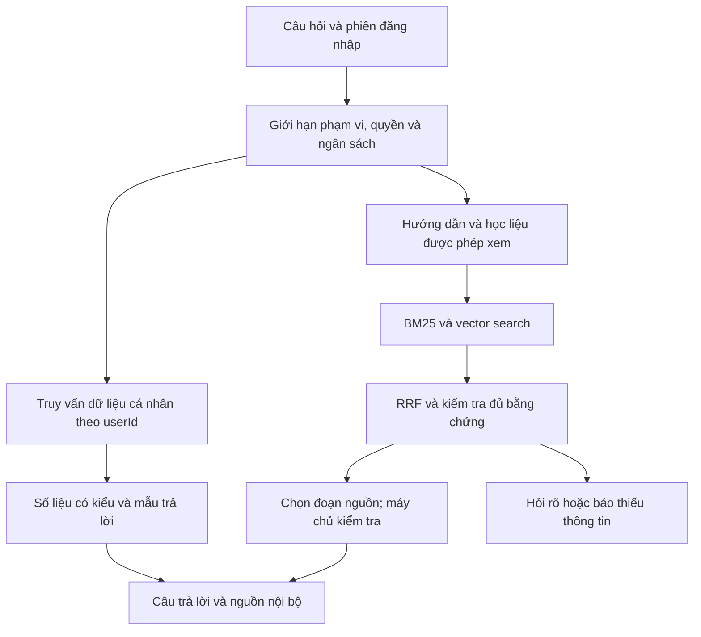

# Nghiên cứu Hybrid RAG cho TCT English — 05/11/2026

Trạng thái: đã khảo sát mã nguồn và tài liệu, **chưa triển khai runtime**.
Nhánh local: `feature/hybrid-rag-chatbot`, tạo từ `master` tại `6af768b`.
Một agent khảo sát và tự review. Không commit/push/PR hoặc thay đổi hosting.

Owner xác nhận demo **25/11/2026**, ưu tiên local. Phạm vi: hướng dẫn tính năng,
dữ liệu của người đang đăng nhập, và kiến thức tiếng Anh có trong bài học/thẻ
mà người đó được quyền xem. Kiến thức ngoài học liệu không được tự bổ sung.

## 1. Video đã tiếp cận như thế nào

- [Liên kết owner gửi](https://vt.tiktok.com/ZSp22UEAj/) chuyển tới
  [video của Dev Step](https://www.tiktok.com/@devstep2108/video/7703921191173573894).
- Công cụ web không mở được TikTok. Trình duyệt mở được trang, đọc tiêu đề,
  mô tả và toàn bộ phụ đề WebVTT tiếng Việt do TikTok cung cấp.
- Tiêu đề trang: “Xây Dựng AI Riêng Cho Doanh Nghiệp: 8 Lớp Kiến Trúc Cốt Lõi”.
  Thời lượng metadata: 116 giây. Phụ đề là ASR, có lỗi nhận dạng; không phải
  bản chép lời thủ công đã kiểm chứng. Không suy diễn nội dung hình/âm thanh
  ngoài những gì trang và phụ đề thể hiện; không lưu video/phụ đề vào Git.

Tóm tắt theo mốc phụ đề: 00:00–00:32 minh họa hạn chế của model và system prompt;
00:32–00:39 thêm truy xuất tài liệu; 00:41–00:58 nối công cụ rồi phát sinh vấn đề
quyền; 00:58–01:15 nhấn mạnh phân quyền và prompt injection; 01:16–01:37 nói về
cache, định tuyến và quan sát/đánh giá; phần cuối cảnh báo thay prompt mà bỏ eval.
Video cung cấp góc nhìn kiến trúc, không cung cấp benchmark hay hướng dẫn BM25,
RRF hoặc cấu hình phù hợp riêng TCT English. Những phần sau là đề xuất dựa trên
mã nguồn và tài liệu chính thức, không gán cho video.

## 2. Hiện trạng được xác minh từ source

| Bằng chứng | Kết luận và ảnh hưởng |
| --- | --- |
| `TCTEnglish/Program.cs:154–182` | Đăng ký ML.NET, 12 retriever, template composer và `InternalKnowledgeProvider`, nhưng `IAiProviderClient` được bind trực tiếp tới `OpenAiProviderClient`. Đăng ký retriever không có nghĩa chat OpenAI đã dùng retrieval. |
| `Services/AI/AiChatService.cs:115–121,184` | Dựng context từ system prompt, câu hỏi, lịch sử rồi gọi provider. Trong phần luồng này không đưa kết quả retriever vào context. |
| `Services/AI/OpenAiProviderClient.cs:31–38` | Gửi các message sang Responses API, `store=false`; payload hiện không có công cụ tìm kiếm hay nguồn nội bộ. Đây là quan sát source, không phải thử nghiệm live. |
| `Services/AI/AiSystemPrompts.cs:10–13` | Prompt yêu cầu dùng snippets và từ chối khi thiếu; yêu cầu này chưa được bảo đảm bằng pipeline cung cấp snippets trên đường chat OpenAI. |
| `Services/AI/AiChatService.cs:16–22,70–72,553–563` | Chặn chuỗi con `password`, nên cả câu hợp lệ “How do I change my password?” cũng bị từ chối trước retrieval. Cần phân biệt hỏi cách đổi mật khẩu với yêu cầu lấy bí mật. |
| `Services/AI/Internal/InternalKnowledgeProvider.cs:40–52` | Đường nội bộ phân loại, dùng ngưỡng 0.55, chỉ gọi retriever khớp intent rồi dùng template. Đây là nền tảng tái sử dụng có điều kiện. |
| `Services/AI/Internal/Retrievers/WebsiteGuideRetriever.cs:37–63,66–92` | Chấm điểm tiêu đề/topic/keyword, trả một guide tốt nhất. Không tìm body bằng BM25; không có tìm vector hoặc RRF. |
| `wwwroot/data/ai/website-guides.json` | Có 41 guide. Có các route `/Home/...` cũ; phải kiểm chứng route chuyển tiếp và nội dung hiện tại trước khi dùng làm nguồn chuẩn. Không coi route cũ mặc nhiên bị hỏng. |
| `Services/AI/Internal/Retrievers/CardLookupRetriever.cs:25–51` | Lọc owner nhưng lấy tối đa 500 card trước khi chấm điểm, không có thứ tự rõ. Thẻ phù hợp ngoài tập đầu có thể không được tìm thấy. |
| `Services/AI/Internal/Retrievers/SpeakingRetriever.cs:35–49` | Query video/playlist không có predicate owner/public. Không được nối nguyên trạng vào đường RAG mới. |
| `Services/SpeakingService.cs:221–239` | Luồng practice áp dụng public/owner và khóa nội dung private với Standard. RAG phải theo cùng quyền/entitlement. |
| `Services/AI/Internal/Retrievers/LearningAreaProgressRetriever.cs:76–78` | Đếm tất cả SpeakingVideos, chưa lọc quyền catalog; có thể làm lộ số lượng private hoặc trả số không tương ứng phần người dùng nhìn thấy. |
| `ViewModels/AI/ChatReplyDto.cs`, `Models/AiMessage.cs`, `Realtime/AiStreamMessages.cs` | Chưa có metadata citation/grounding riêng. Thiết kế phải xử lý HTTP, stream completion, lịch sử và reload đồng nhất. |
| Call graph `IAiProviderClient` | Provider được dùng cả ở VocabSuggest, WritingAiEvaluation, ReadingTranslation và các consumer khác. Thay toàn bộ DI sang RAG có thể làm sai các chức năng này. |
| `TCTEnglish.csproj`, `TCTEnglish.Tests.csproj` | net9.0, EF Core 9.0.4, Pomelo 9.0.0. Không đề xuất nâng framework chỉ để thêm RAG. |

Các phát hiện trên là review mã nguồn; chưa tái hiện bằng browser/chat live.
Các retriever cũ không nằm trên đường provider chat được đăng ký hiện tại, nên
không kết luận đã có rò rỉ qua chatbot OpenAI đang chạy. Tuy nhiên, kiểm soát
quyền là điều kiện bắt buộc trước khi kích hoạt chúng.

Đã đọc bug memory liên quan quota/cancel/history ngày 02/11 và migration OpenAI
ngày 01/11. Kế hoạch mới phải giữ settlement khi đã biết usage, scope DbContext
cách ly, Stop/cancel và thứ tự phân trang. Tài liệu RAG tháng 04 là lịch sử;
quyết định bỏ Gemini hoặc dùng ML.NET trước đây không thay thế source OpenAI và
yêu cầu Hybrid RAG hiện tại.

## 3. Kiến trúc đề xuất cho demo local

**Hybrid retrieval** là kết hợp tìm từ khóa BM25 và tìm ngữ nghĩa bằng embedding.
BM25 hữu ích cho tên tính năng, cụm từ, mã và tên bài; vector hữu ích cho cách
hỏi khác cách diễn đạt trong nguồn. RRF ghép thứ hạng, không cộng trực tiếp hai
loại điểm khác thang. Đây là nguyên lý được mô tả trong
[Microsoft Hybrid Search](https://learn.microsoft.com/en-us/azure/search/hybrid-search-overview)
và [RRF](https://learn.microsoft.com/en-us/azure/search/hybrid-search-ranking).

Một đường riêng lấy số liệu có cấu trúc theo tài khoản bổ sung cho retrieval:
tiến độ, streak, mục tiêu, số set, lớp và quyền Premium. Những số liệu thay đổi
không nên lấy từ bản embedding cũ. Câu “hôm nay” phải dùng business date/timezone
của chức năng gốc, không tự đồng nhất với ngày UTC.

Giữ OpenAI text transport/model hiện tại theo source; không đổi model để giải
quyết thiếu grounding. Đề xuất thử `text-embedding-3-small` riêng cho embedding,
kiểm chứng quyền model/chất lượng tiếng Việt trước khi chốt. Tài liệu
[OpenAI embeddings](https://developers.openai.com/api/docs/guides/embeddings)
mô tả embedding và kích thước mặc định 1536; tài liệu
[OpenAI retrieval](https://developers.openai.com/api/docs/guides/retrieval)
cũng mô tả cân bằng kết quả text/embedding bằng hybrid ranking. Không cần chuyển
dữ liệu sang dịch vụ vector store của OpenAI để áp dụng nguyên lý này.

## 4. Lưu chỉ mục ở đâu

Hosting theo hợp đồng dự án là MariaDB 10.5.23. Tài liệu
[MariaDB Vector](https://mariadb.com/docs/server/reference/sql-structure/vectors/vector-overview)
ghi vector có từ Community 11.7, GA từ 11.8; 10.5 không đáp ứng. Đây là đối chiếu
phiên bản trong repo với tài liệu, không phải đo phiên bản DB đang chạy.

| Lựa chọn | Đánh giá cho demo 25/11 |
| --- | --- |
| Chỉ mục dẫn xuất trên ổ D, BM25 + cosine trong .NET | Đề xuất đầu tiên nếu corpus và benchmark phù hợp: ít thành phần vận hành, kiểm soát quyền và thuật toán rõ. |
| Dịch vụ search/vector riêng | Phù hợp khi cần mở rộng; tăng cấu hình, backup, độ trễ mạng và kiểm thử ACL. Chưa cần cho demo nhỏ nếu benchmark trong process đạt. |
| Vector store được quản lý | Có hybrid search sẵn nhưng cần đánh giá việc đưa học liệu lên dịch vụ, phí và quyền theo từng tài khoản. Chưa chọn. |
| Nâng MariaDB hosting | Không thuộc phạm vi chuẩn bị demo local. Không tự nâng server hoặc thay provider. |

Chỉ mục đề xuất nằm trong ignored `.appdata/local/ai-rag` ngoài `wwwroot`.
Đó là cache dẫn xuất, không phải nguồn chân lý hay bản sao DB. Dùng source key,
content hash, phiên bản corpus/chunker/model/dimension; ghi bản mới rồi đổi
manifest nguyên tử. Không tự embedding toàn bộ dữ liệu lúc startup.

Trước khi chốt phương án phải đo số tài liệu/chunk, RAM và thời gian tìm kiếm.
Ví dụ tính toán, không phải số đo: 10.000 vector × 1536 × 4 byte xấp xỉ 58,6 MiB,
chưa gồm text, BM25, object và cache. Khởi đầu với giới hạn corpus rõ ràng, không
quét hoặc load không giới hạn. Nếu không đạt, cập nhật thiết kế trước khi mở rộng.

Chỉ đưa FAQ đã review và học liệu public/published vào chỉ mục dùng chung. Thẻ,
draft, video private và dữ liệu cá nhân được truy vấn theo quyền; chưa có semantic
index riêng thì phải nói rõ đó là đường lexical/live, không quảng cáo đã tìm vector
trên mọi dữ liệu riêng tư. Không để snapshot cá nhân vào gói dữ liệu dùng chung.

## 5. “Không bịa, không trả lời bên ngoài” được thực hiện thế nào

Không thể cam kết trả lời đúng mọi câu hỏi chỉ nhờ thêm RAG hoặc system prompt.
Chỉ mục cũng có thể thiếu, cũ hoặc chứa dữ kiện sai. Mục tiêu kiểm chứng là bao phủ
phạm vi học liệu đã chuẩn hóa, trả lời có căn cứ và biết dừng đúng lúc.

1. Máy chủ phân biệt `answered`, `needs_clarification`, `insufficient_evidence`,
   `out_of_scope`, `temporarily_unavailable`; lỗi API không được gọi là ngoài phạm vi.
2. Kiểm tra quyền trước khi lấy/đưa evidence vào model, trước cache lookup phù hợp,
   và ngay trước dùng kết quả. Thu hồi quyền/unpublish phải vô hiệu hóa nguồn cũ.
3. Chế độ demo nghiêm ngặt dùng số liệu có kiểu + template. Với hướng dẫn/học liệu,
   model chỉ chọn các sentence ID đã cung cấp; server lấy nguyên văn câu tương ứng
   và các câu nối cố định. ID không hợp lệ hoặc nguồn không đủ thì từ chối an toàn.
4. Dịch/giải thích tiếng Anh chỉ khi phần nghĩa, bản dịch, ví dụ hoặc giải thích đó
   đã có trong nguồn. Không tự tạo quy tắc ngữ pháp hay ví dụ ngoài học liệu.
5. Nếu sau này cho phép model diễn giải tự do, phải đánh giá riêng độ hỗ trợ từng
   nhận định. Citation hợp lệ/JSON đúng schema không chứng minh nội dung đúng.
   [OpenAI Structured Outputs](https://developers.openai.com/api/docs/guides/structured-outputs)
   nêu rõ schema vẫn có thể dẫn tới hallucination với đầu vào không phù hợp.
6. Tài liệu/thẻ là dữ liệu không đáng tin về mặt chỉ dẫn. Nội dung “bỏ qua quy tắc”
   không được điều khiển pipeline. Không cho chatbot SQL tự do, sửa dữ liệu hoặc
   tự duyệt web. MCP không bắt buộc để gọi service trong cùng ứng dụng.
7. RRF score/cosine/classifier score chỉ là tín hiệu truy xuất; không hiển thị
   thành xác suất câu trả lời đúng. Câu nhiều ý phải kiểm tra từng ý.
8. Link nguồn do server tạo từ route đã cho phép. Không để model tạo đường dẫn,
   không lộ Admin route/private ID; title/text được encode và kiểm tra quyền khi mở.
   Nếu câu trả lời cũ chứa học liệu đã bị thu hồi quyền, phải che cả nội dung câu
   trả lời liên quan khi đọc lịch sử và khi dựng context, không chỉ ẩn citation.

Ví dụ chính sách trả lời (dữ liệu minh họa, không phải kết quả chạy thực tế):

- “Tạo bộ thẻ ở đâu?” → hướng dẫn từ FAQ đã kiểm tra + link màn hình thực tế.
- “Hôm nay tôi đã hoàn thành gì?” → số liệu live của người hiện tại + thời điểm.
- “Giải thích cụm từ trong thẻ này” → chỉ nghĩa/ví dụ của thẻ được quyền xem.
- “Giá vàng hôm nay?” → ngoài phạm vi; không tìm web hay dùng trí nhớ model.
- “Bài này dùng cấu trúc gì?” khi chưa biết bài → hỏi rõ bài, không đoán.
- “Thẻ này thiếu nghĩa, tự nghĩ giúp tôi” → báo học liệu chưa có thông tin.

## 6. Ưu tiên và đánh đổi

P0: nối đúng pipeline chat, rà soát quyền, chuẩn hóa nguồn và có bộ eval trước
khi cho model sinh câu trả lời mới. Không bind RAG thay `IAiProviderClient` toàn cục.
P1: BM25/vector/RRF, giữ hội thoại có tham chiếu rõ, citation tồn tại sau reload,
cache theo scope và fallback khi mất mạng. P2 sau demo: reranker bổ sung, private
semantic index quy mô lớn, công cụ ghi dữ liệu, admin ingest UI và vận hành staging.

Local app vẫn phụ thuộc mạng khi gọi OpenAI. Khi mạng/API lỗi có thể dùng lexical
retrieval + các đoạn nguồn/template, hiển thị trạng thái rõ ràng. Đây là chế độ
suy giảm, không phải bằng chứng Hybrid RAG đầy đủ đang hoạt động offline.

Chưa có số đo p95, recall hoặc chi phí thực tế. Chỉ nên hứa khả năng demo sau khi
có eval và diễn tập trên đúng máy, dữ liệu, tài khoản dùng ngày 25/11.

## 7. Tài liệu tiếp theo và bằng chứng hiện tại

- [Kế hoạch triển khai](../superpowers/plans/2026-11-05-hybrid-rag-chatbot.md).
- [Prompt triển khai chuẩn bị sẵn](../../.ai/prompts/hybrid-rag-chatbot-execution.md).
- Đã xác minh nhánh, HEAD, working tree ban đầu, source/call graph và 41 guide.
- Đã đọc trang video/phụ đề và các tài liệu chính thức được liên kết ở trên.
- Chưa sửa code, schema, nội dung học liệu hoặc cấu hình. Vì vậy chưa có migration
  hay export package cần tạo cho lượt nghiên cứu này.
- Không chạy chatbot live, không dùng key, không gọi API embedding/text/speech trả
  phí, không chạy web hoặc thay đổi DB. Chưa có nghiệm thu runtime/CI/production.
- Kiểm tra tài liệu: ba file UTF-8 hợp lệ, không trailing whitespace, các link
  local và 12 đường dẫn source/script tham chiếu tồn tại; đường dẫn chỉ mục đề xuất
  được `.gitignore` bao phủ; `git diff --check` sạch.
- `uv run --no-project python scripts/agent_tooling.py`: PASS.
- `uv run --no-project python -m unittest discover -s scripts/tests -v`:
  **135 test, 134 pass, 1 skip** (55,483 giây). Test bị skip là nhánh host không
  phải Windows. Các test staging/deploy dùng fixture; không phát hành lên hosting.
  Đây là bằng chứng tooling, không phải kết quả kiểm thử chatbot/RAG.
