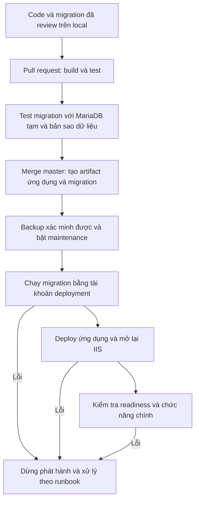

# Chạy local và phát hành TCT English lên Nhân Hòa

Ngày đối chiếu mã nguồn: 30/10/2026. Tài liệu này giữ thiết kế/review ban đầu.
Sau khi owner chấp thuận, setup Docker local và CI/Plesk đã được thực hiện,
PR #120 đã merge; CI master 41058398407 thành công. Dùng hướng dẫn hiện hành:

- [Khởi động local đã setup](local-development-quickstart.md).
- [Release Plesk, bằng chứng và điều kiện kích hoạt](plesk-cicd-runbook.md).

Các phương án MSI/FTP bên dưới là tham khảo lịch sử, không phải yêu cầu cài thêm.
Local đang chạy Docker MariaDB 10.5.23, không cần cài SSMS/MariaDB MSI.

Thông tin hosting owner đã cung cấp: **Sinh Viên N518 / Plesk**,
`tctenglish.site`, MariaDB **10.5.23**. Metadata/backup từ hosting đã xác nhận.
Endpoint DB từ xa không hỗ trợ TLS; phương án đã chọn chạy migrator tại hosting
qua loopback và điều khiển bằng Git/Plesk HTTPS, không gửi DB password từ CI.
Production gate vẫn false chờ rotation và diễn tập release/recovery trên staging.

## 1. Chọn đúng database

Ứng dụng hiện dùng Pomelo 9.0.0, EF Core 9.0.4 và MySQL/MariaDB. Owner cho biết
hosting có vẻ dùng MariaDB trên Windows. SSMS quản lý SQL Server, không cung cấp
MariaDB Server cho dự án này. Không cần cấu hình lại SQL Server để chạy mã hiện
tại; cũng không cần gỡ SQL Server/SSMS đang dùng cho dự án khác.

Máy đã có SDK .NET 10.0.300 và runtime ASP.NET Core/.NET 9.0.16. Target ứng dụng
vẫn là net9.0. Cập nhật patch được hỗ trợ và lập kế hoạch LTS riêng; không đổi
csproj chỉ vì số phiên bản SDK khác target.

## 2. Cài MariaDB local

Phương án ít phụ thuộc cho Windows hiện tại: cài MariaDB Server bằng MSI, chạy
thành Windows service. Docker là phương án thay thế nếu bạn đã vận hành Docker
Desktop; không bắt buộc để deploy lên IIS shared hosting.

1. Hỏi/đọc panel Nhân Hòa để biết chính xác phiên bản MariaDB, charset/collation.
2. Chọn cùng dòng phiên bản cho local nếu còn được hỗ trợ và phù hợp Pomelo.
   Pomelo 9.0.0 công bố đã test MariaDB 10.6, 10.11, 11.4 và các phiên bản khác
   trong release notes; không mặc định chọn một bản mới bất kỳ.
3. Tải từ [MariaDB](https://mariadb.org/download/) và làm theo
   [hướng dẫn MSI Windows](https://mariadb.com/docs/server/server-management/install-and-upgrade-mariadb/installing-mariadb/binary-packages/installing-mariadb-msi-packages-on-windows).
4. Chạy service, dùng cổng 3306 nếu còn trống, giới hạn truy cập database dev ở
   máy local. Không mở cổng ra Internet để phục vụ local development.
5. Cài một GUI hỗ trợ MariaDB, ví dụ
   [DBeaver Community](https://dbeaver.com/edition/community/), hoặc HeidiSQL nếu
   đã có. Kết nối `127.0.0.1`, cổng đã chọn, bằng tài khoản quản trị local.

Tạo database và tài khoản dev trong GUI. Ví dụ dưới đây **chỉ dùng cho MariaDB
local**, thay chuỗi mật khẩu mẫu trước khi chạy:

```sql
CREATE DATABASE tctenglish_dev CHARACTER SET utf8mb4 COLLATE utf8mb4_unicode_ci;
CREATE USER 'tct_dev'@'127.0.0.1' IDENTIFIED BY 'THAY_BANG_MAT_KHAU_LOCAL_RIENG';
GRANT ALL PRIVILEGES ON tctenglish_dev.* TO 'tct_dev'@'127.0.0.1';
```

Nếu hosting dùng collation khác, đối chiếu để chọn giá trị tương thích. Quyền
rộng trên database dev phục vụ migration; tài khoản app production nên tách
khỏi tài khoản deployment có quyền đổi schema.

## 3. Cấu hình local trước khi chạy bất kỳ lệnh database nào

Thực hiện ở thư mục gốc repository. Project đã có `UserSecretsId`, không cần
`user-secrets init` hoặc sửa csproj. Dùng mật khẩu riêng cho dev, không copy
credentials production vào ví dụ hay chat:

```powershell
dotnet user-secrets set 'ConnectionStrings:DefaultConnection' 'Server=127.0.0.1;Port=3306;Database=tctenglish_dev;User=tct_dev;Password=THAY_BANG_MAT_KHAU_LOCAL_RIENG;' --project TCTEnglish
```

User Secrets được ASP.NET Core nạp trong Development và nằm ngoài Git. Không
đưa mật khẩu vào file cấu hình được commit. Nếu đang có environment variable
`ConnectionStrings__DefaultConnection` hoặc argument command line cùng tên,
chúng có thể override User Secrets; kiểm tra nguồn cấu hình mà không in secret.
Xem [hướng dẫn Microsoft](https://learn.microsoft.com/en-us/aspnet/core/security/app-secrets?view=aspnetcore-9.0).

Cấu hình OAuth, SMTP, AI, payment sandbox riêng khi kiểm thử các tính năng đó.
Mã hiện tại cho phép khởi động với OAuth chưa cấu hình bằng giá trị dummy, nhưng
đăng nhập Google/Facebook cần ứng dụng OAuth dev và callback localhost đúng.
Không dùng credentials bị public trong repo làm cấu hình chuẩn để tiếp tục test.

## 4. Tạo schema hoặc dùng bản sao dữ liệu

### Database dev mới, trống

Chỉ tiếp tục sau khi kết nối đã chắc chắn là `127.0.0.1` và database dev riêng.
Ứng dụng hiện gọi migration và một số seeder lúc startup. Có thể chạy profile
Development sau khi cấu hình local; nếu muốn cập nhật database bằng lệnh riêng,
dùng EF tool 9.x phù hợp với dự án.

Ví dụ cài tool tạm trong thư mục đã được Git ignore, không thay global tool:

```powershell
dotnet tool install dotnet-ef --tool-path .tmp/dotnet-tools --version 9.0.4
$env:ASPNETCORE_ENVIRONMENT = 'Development'
$env:DOTNET_ENVIRONMENT = 'Development'
.\.tmp\dotnet-tools\dotnet-ef.exe database update --project TCTEnglish --startup-project TCTEnglish
```

Nếu tool đã tồn tại, kiểm tra version trước khi dùng; không cần chạy lệnh install
mỗi ngày. Trước khi thực hiện EF CLI phải bảo đảm môi trường Development và
nguồn cấu hình không trỏ hosting. Hướng dài hạn là local tool manifest đã pin
trong repo và design-time context không phụ thuộc kết nối production.

Hiện đã sinh SQL offline thành công, nhưng chuỗi migration chưa được chạy trên
MariaDB local thật trong lần review. Nếu gặp lỗi schema, giữ nguyên database lỗi
để chẩn đoán, không thêm lệnh DROP hoặc đánh dấu migration đã chạy để vượt lỗi.

### Cần dữ liệu giống hosting

Lấy bản backup/export nhất quán của MariaDB, restore vào database local riêng,
giữ cả `__EFMigrationsHistory`, làm ẩn dữ liệu cá nhân và credentials/token.
Đối chiếu history/schema trước khi apply migration còn thiếu.

Không restore đè database production; không dùng database hosting trực tiếp
để phát triển. Migration `20260510020134_AddReadingUserTranslation` có DROP
hai bảng trong Up, nên phải kiểm tra nó đã được áp dụng hay chưa trên bản sao.
Backup SQL Server `.bak`/MDF cũ không thể restore trực tiếp thành MariaDB; nếu
chỉ còn backup SQL Server thì cần một công việc chuyển schema/data riêng.

### Dữ liệu hiện tại đang được cấu hình ở đâu?

Kết nối Development hiện lấy từ `appsettings.json`, database
`nhtctsnn_tctenglish` trên server từ xa, cổng 3306. Chưa có override local hoặc
MariaDB Docker chạy trên máy ở thời điểm kiểm tra. Vì vậy chưa có một bản sao
database dev độc lập được xác minh; chạy app hiện tại có thể ghi thẳng vào DB
từ xa. Điều này không chứng minh cấu hình Production thật của website giống hệt.

Để kiểm tra dữ liệu mà không gửi mật khẩu qua chat: trong Plesk chọn
**Databases → nhtctsnn_tctenglish → phpMyAdmin**, xác nhận tên database và xem
danh sách bảng. Có thể dùng các truy vấn chỉ đọc sau, sau khi xác nhận tên bảng:

```sql
SELECT DATABASE() AS CurrentDatabase, VERSION() AS ServerVersion;
SHOW TABLES;
SELECT COUNT(*) AS UserCount FROM `Users`;
SELECT COUNT(*) AS SetCount FROM `Sets`;
SELECT COUNT(*) AS CardCount FROM `Cards`;
SELECT `MigrationId` FROM `__EFMigrationsHistory` ORDER BY `MigrationId`;
```

Không cần xuất nội dung user, email, password hash, token hoặc connection string.
Nếu thiếu bảng, giữ lỗi và thông tin schema để đối chiếu; không chạy migration
hoặc tạo bảng trên hosting chỉ để các truy vấn kiểm tra chạy được.

### Backup đã được owner cung cấp và kiểm tra

Đã có ZIP SQL của `nhtctsnn_tctenglish`, dump hoàn tất 26/09/2026 16:57:18,
server 10.5.23: 52 bảng, 8.260 row INSERT, gồm 57 users, 36 sets, 162 cards.
Đây là snapshot có thể dùng để dựng dev và thử upgrade, chưa đại diện đầy đủ
dữ liệu live hiện nay. Trước production cần backup mới và restore drill.
SQL chứa dữ liệu thật: lưu ngoài Git, ẩn thông tin nhạy cảm khi cần; không dùng
tài khoản/email/payment/token của bản sao để gọi dịch vụ production.

Backup có history của nó, gồm migration DROP ở mục cảnh báo đã áp dụng; bốn
migration tháng 10 trong source chưa có ở snapshot. Có thêm history ID
20260509145534 không còn source: đối chiếu thay vì xóa/sửa history.

Dump tạo các bảng lowercase từ Windows. Docker Linux dev cần
`lower_case_table_names=1` từ lần khởi tạo volume đầu tiên để phù hợp query EF
đang dùng PascalCase. Không thay tham số sau khi datadir đã khởi tạo, không
xóa volume có dữ liệu để thử lại mà chưa xác nhận phạm vi/backup. Restore xong
phải kiểm tra row counts/history rồi mới apply bốn migration mới.

## 5. Chạy và test

```powershell
dotnet restore TCTEnglish/TCTEnglish.csproj
dotnet build TCTEnglish/TCTEnglish.csproj --configuration Release
dotnet test TCTEnglish.Tests/TCTEnglish.Tests.csproj --configuration Release
dotnet run --project TCTEnglish --launch-profile http
```

Mở [http://localhost:5100](http://localhost:5100). Thử đăng ký/đăng nhập bằng
tài khoản test, tạo bộ thẻ và kiểm tra ghi dữ liệu đúng database dev. Khởi động
lại app để kiểm tra migration/seed có thể chạy lại. Bộ test hiện tại chủ yếu
dùng SQLite/InMemory nên chạy test pass chưa xác nhận kết nối MariaDB của web.

Tính năng nâng cao có phụ thuộc riêng; đọc khi cần:
[speech](local-speech.md), [speaking import](speaking-import.md),
[writing engines](local-writing-engines.md). IIS hosting không tự cung cấp
Whisper/Ollama/LanguageTool chỉ vì đã upload ứng dụng .NET.

## 6. Quy trình phát hành đề xuất



Pipeline nên tự động phát hành bản build/publish đã kiểm chứng: exe/DLL, views,
static assets và config production được dựng an toàn. Không cần upload toàn bộ
repository, source C#, `.git`, tests hoặc SDK lên hosting.

Thay đổi schema được commit bằng EF migration cùng code, rồi pipeline chạy
migration đó. Pipeline không tự sinh migration production từ model, không copy
database local đè dữ liệu người dùng thật. Dữ liệu danh mục cần đưa lên bằng
seeder/data migration có thể chạy lại, có review và quyền phù hợp.

### Chọn cách thực thi migration theo quyền hosting

| Điều kiện thực tế | Cách phù hợp |
| --- | --- |
| GitHub runner truy cập được DB qua TLS và IP allowlist do hosting cho phép | Chạy migration bundle ở runner, tài khoản DDL riêng; không cần SDK trên IIS |
| DB chỉ truy cập nội bộ; có SSH/remote command hoặc runner riêng trong mạng tin cậy | Thực thi bundle bên trong mạng đó; không đặt runner trên shared hosting không cho phép |
| Chỉ có FTP và panel, không có remote command, DB không cho runner kết nối | FTP chỉ upload file, không thực thi migration; cần API/cơ chế backup/deploy được Nhân Hòa hỗ trợ hoặc bước DB thủ công tạm thời |

Trước khi chọn phương án phải xác nhận phiên bản DB, TLS/allowlist, quyền ALTER,
CREATE, INDEX, cách backup/restore và endpoint kiểm tra website. Không mặc định
shared hosting có SSH, không tạo endpoint HTTP public để chạy migration.

Build migration bundle/SQL trong CI; test trên MariaDB thật trước khi deploy.
Đối với production, chuyển migration khỏi startup sang bước release có log,
timeout, kiểm tra exit code và lock deploy. Việc sửa `Program.cs` thuộc phạm vi
bảo vệ, chỉ thực hiện khi owner đã giao triển khai rõ ràng.

Yêu cầu phát hành: FTPS hoặc transport có mã hóa; serializer cho config;
`concurrency` không hủy deploy đang ghi file; artifact có version/checksum;
backup database đã thử restore; bảo toàn uploads và Data Protection keys;
kiểm tra readiness có database, không chỉ HTTP 200 của trang tĩnh.

Rollback ứng dụng chỉ an toàn khi schema mới vẫn tương thích với bản cũ. Không
tự rollback database bằng Down hoặc restore backup trên database đang nhận ghi:
MariaDB DDL không phải lúc nào rollback theo transaction; restore có thể mất
dữ liệu phát sinh sau backup. Runbook phải định rõ maintenance, quyền quyết định
và cách phục hồi. Khi upload dở dang, phục hồi bộ file hợp lệ trước khi online.

### Git extension trên Plesk có thể giúp gì?

Ảnh owner gửi đang là form Add Repository, URL chưa nhập; chưa có bằng chứng
repo đã kết nối. Plesk có pull/webhook và post deployment actions theo
[tài liệu chính thức](https://doc.plesk.com/en-US/obsidian/customer-guide/git-support/using-remote-git-hosting.75848/).
Checkbox không chứng minh gói cho chạy .NET SDK/exe/bundle hoặc backup database.

Hướng cơ sở vẫn là CI build/test/publish trước. Có thể tiếp tục đường upload
được mã hóa của workflow hiện có; nếu Git post actions thật sự khả dụng, đánh
giá một release qua staging để migrator chạy từ hosting. Không bật auto pull
source master trực tiếp vào `\httpdocs`, không để Plesk và Actions cùng ghi
một site. Git post actions chỉ chạy sau Git deployment, không tự chạy sau FTP.
Nếu chọn Plesk release, chỉ kích hoạt sau CI pass và phải giữ trình tự
maintenance/backup/migration/release/readiness, không dựa vào Git pull đơn thuần.

## 7. Thứ tự làm tiếp

1. Thay mới credentials đã public, cập nhật các nơi sử dụng và dọn config Git.
2. Xác nhận MariaDB version; cài database dev và User Secrets local.
3. Chạy app thật và migration trên database dev; xác nhận dữ liệu local độc lập.
4. Sửa lỗi CI Linux; thêm kiểm thử migration MariaDB và PR checks.
5. Chọn đường truy cập DB/backup theo quyền Nhân Hòa thực tế; triển khai release
   workflow trên staging rồi mới bật production.

Checklist triển khai và tiêu chí chấp nhận nằm trong
[kế hoạch remediation](../superpowers/plans/2026-10-30-local-database-cicd-remediation-plan.md).
