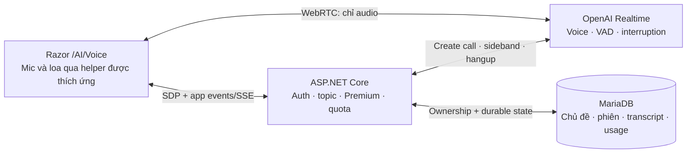

# AI Voice Conversation — kế hoạch triển khai theo phase

Ngày: 18/11/2026. Nhánh đã tạo và đang chọn: `feature/ai-voice-conversation`.
Baseline lúc khảo sát: `e6be0e140ed73b9610cee9495934e82046b5b073` từ `master`.
Agent thực thi theo lựa chọn của Châu: **GPT 6.1 Sol, reasoning High, một agent**.

**Owner update 19/11/2026:** yêu cầu ngắt lời AI trong bản kế hoạch này đã được
thay bằng nói lần lượt: AI nói hết rồi người dùng nói, do tạp âm dễ làm ngắt câu.
Áp dụng [sequential-turn plan](2026-11-19-voice-sequential-turns.md) cho hành vi hiện tại;
các mục interruption dưới đây là thiết kế/kiểm tra lịch sử.

**Mục tiêu:** thêm hội thoại giọng nói trực tiếp vào chatbot AI: chọn chủ đề có
sẵn, tự nhận biết lượt nói, nghe AI trả lời và ngắt lời AI; Premium được tạo và
dùng chủ đề riêng. Tận dụng mã nguồn mở/phần có sẵn trước khi viết phần mới.

**Thiết kế đề xuất:** thích ứng ví dụ OpenAI `realtime-server-controlled` đã ghim
revision vào Razor/vanilla JS và backend .NET; dùng OpenAI Realtime cho voice.
Chủ đề, entitlement, dữ liệu cá nhân và quota do server TCT quản lý. Chat chữ và
RAG hiện tại tiếp tục theo contracts cũ.

**Tech stack đã kiểm:** ASP.NET Core MVC/Razor `net9.0`, EF Core `9.0.4`, Pomelo
`9.0.0`, MariaDB mục tiêu `10.5.23`; Bootstrap/JS hiện có. Không đổi target SDK.

**Đặc tả:** yêu cầu chủ dự án được xác nhận trong chat và phần 1–4 dưới đây.
**Khảo sát nguồn:** [reuse research](../../feature-audits/2026-11-18-ai-voice-conversation-reuse-research.md).
**Prompt thực thi:** [Sol High prompt](../../../.ai/prompts/implement-ai-voice-conversation-sol-high.md).

## 1. Phạm vi và quyền hiện tại

- Lần làm việc này được phép tạo/kiểm tra nhánh, khảo sát và viết tài liệu.
  Các checkbox triển khai bên dưới đều chưa hoàn thành; tài liệu không cấp
  quyền tự bắt đầu triển khai trong phiên lập kế hoạch này.
- Khi chủ dự án yêu cầu thực thi prompt: làm local theo phạm vi được giao,
  kiểm tra và bàn giao; không tự commit/push/PR/remote CI/merge/deploy.
- `Program.cs`, `appsettings.json`, `.csproj` vẫn cần quyền rõ ràng theo
  `AGENTS.md`. Phase 0 chuẩn bị đề xuất cụ thể cho đăng ký DI/options/worker nếu
  cần; chỉ xin quyền còn thiếu khi đã có nội dung review được. Không lặp lại
  yêu cầu đã được chủ dự án cấp trong chat thực thi.
- Không đổi key/User Secrets, reset dev DB, sao chép DB lên hosting, sửa cấu
  hình Plesk hoặc mở gate staging/production. Paid live acceptance cần quyền
  và budget riêng. Không mang hướng dẫn chạy/cài công cụ upstream thành quyền.

## 2. Yêu cầu đã xác nhận và lựa chọn đề xuất

| Loại | Nội dung |
| --- | --- |
| Đã xác nhận | Hội thoại trực tiếp; tự nhận biết khi ngừng nói; cho phép ngắt lời AI. Không hạ thành luồng bấm ghi âm rồi gửi từng lượt. |
| Đã xác nhận | Chọn chủ đề có sẵn trong website; Premium được tự tạo chủ đề. |
| Đã xác nhận | Hai phía giao tiếp bằng giọng nói, tích hợp với chatbot AI hiện có. |
| Đã xác nhận | Dùng GPT 6.1 Sol / High cho việc lập trình; ưu tiên GitHub/SDK/mã nguồn mở có sẵn. |
| Đề xuất v1 | Mọi tài khoản đã đăng nhập được dùng catalog công khai trong hạn mức; Premium/Admin được tạo và bắt đầu chủ đề riêng theo entitlement hiện có. Không mở cho anonymous. |
| Đề xuất v1 | Trò chuyện tiếng Anh mặc định theo vai/ngữ cảnh, câu ngắn tự nhiên, một câu hỏi mỗi lượt; giao diện và trợ giúp tiếng Việt. Chủ đề riêng có mô tả tiếng Việt/Anh. |
| Đề xuất v1 | Lưu chủ đề riêng và transcript riêng tư để xem/xóa lịch sử; không lưu audio thô. Người dùng có thông báo trước khi bật micro. |
| Đề xuất v1 | Trang `/AI/Voice` riêng, link từ full chat và embed/launcher; chưa đưa mic trực tiếp vào iframe. |
| Đề xuất v1 | Catalog được quản lý bằng seed có thể chạy lại + shared package đã review. Chưa cần một bộ Admin CRUD mới. |
| Chưa xác minh | Model voice/tài khoản có quyền Realtime, mức phí, vận hành sideband/SSE trên hosting và chất lượng micro thực tế. |

Không tự thêm chấm phát âm, avatar video, room nhiều người, gọi điện thoại,
RAG truy cập dữ liệu cá nhân bằng voice, dịch realtime hoặc đổi model chat chữ.
Các phần đó có thể làm riêng sau khi phiên bản này đạt nghiệm thu.

## 3. Nền tảng source đã khảo sát

| Source đã kiểm | Ý nghĩa với implementation |
| --- | --- |
| `TCTEnglish/Controllers/AiController.cs` | `[Authorize]`, antiforgery, route `/AI/Chat`, paged history, send/delete/usage. Giữ nguyên. |
| `TCTEnglish/Services/AI/AiChatService.cs`, `AiConversationService.cs` | Chat chữ có ownership, concurrent lease và token reservation. Không gọi pipeline RAG như một vòng voice engine. |
| `TCTEnglish/Models/AiConversation.cs`, `AiMessage.cs` | Hiện chưa biểu diễn session voice/topic/audio usage. Đề xuất bảng voice riêng để tránh thay contracts lịch sử chat chữ. |
| `TCTEnglish/Services/AI/AiOptions.cs` | Text model mặc định `gpt-6-luna`/`low`. Model IDE Sol High và model voice là ba cấu hình khác nhau. |
| `TCTEnglish/Services/Billing/PremiumAccessService.cs` | `HasFeatureAsync(int userId, string featureKey, CancellationToken)` đọc DB và hỗ trợ Admin/legacy Premium/active subscription; không chỉ role cookie. |
| `TCTEnglish/Services/Billing/SubscriptionService.cs` | Có `ExpireForUserAsync`; cần xử lý user vừa hết hạn trước gate mutation. Gate cũ cho role Premium nên gọi expiry phù hợp hoặc dùng policy thuần đã kiểm. |
| `TCTEnglish/Security/PremiumFeatures.cs` | Thêm khóa riêng cho custom voice topic và giữ các khóa cũ. |
| `TCTEnglish/Views/Ai/_ChatShell.cshtml`, `ChatEmbed.cshtml` | Shell dùng chung full page/embed. Entry point mới phải giữ selectors/IDs và chat chữ. |
| `TCTEnglish/Infrastructure/SharedData/SharedDataRegistry.cs` | Catalog voice chưa là kiểu allowlisted. Script Export hiện nhận `EntityId` kiểu `int`; catalog topic nên dùng khóa int. |
| `TCTEnglish/Services/Accounts/AccountDeletionService.cs` | Quy trình xóa/anonymize tài khoản đã có; cần tham gia cleanup phiên và dữ liệu voice. |

Source chưa khảo sát đủ để khẳng định chi tiết: đăng ký DI hiện hành trong
`Program.cs`, mapping DbContext của toàn bộ bảng, command/export/apply paths của
shared data và mọi handler của `ai-chat.js`. Đọc focused ở phase liên quan qua
CodeGraph; không đoán chữ ký/đường dẫn còn thiếu. Không auto rebuild index.

## 4. Kiến trúc và các contract dự kiến

### 4.1 Reuse trước, glue sau

Nguồn chính: OpenAI revision `1215a24fb4725742c7b88094812b7ba18c46041c`,
`examples/realtime-server-controlled/`. Bản đồ source → đích và license nằm trong
research. Chuyển helper browser TypeScript thành vanilla JS; chuyển SDP policy,
readiness và cleanup vào backend .NET. VAD, audio generation và turn detection
do Realtime/provider thực hiện; không viết lại engine.

Ưu tiên API/SDK đã chứng minh hỗ trợ đúng protocol. SDK .NET khảo sát vẫn có
Realtime experimental; support unified call/sideband chưa được chứng minh. Chỉ
thêm package nếu spike cho thấy giảm code và được duyệt `.csproj`. Nếu không,
adapter C# nhỏ dùng `HttpClient`/`ClientWebSocket` là phần glue cần thiết.



Server xác thực SDP offer **và** answer: đúng một media audio đang hoạt động,
không video/data channel/additional media. Chỉ bỏ `createDataChannel()` trong
JS là chưa đủ. Call ID/key/SDP đầy đủ không được log; provider call ID không trả
cho browser. Chỉ trả SDP answer và app session ID. Chờ ACK cấu hình đúng trước
khi hoàn tất signaling; initialization lỗi phải hangup cuộc gọi đã tạo.

App events gửi qua SSE cùng origin/cookie và có ownership. Transcript được
chiếu riêng cho chủ phiên; không forward raw provider events, instructions,
tool metadata, credential hoặc raw errors. Voice v1 không có privileged tools.

### 4.2 Entity đề xuất, migration additive

Tên dưới đây là **thiết kế mới**, không phải entity có sẵn. Chốt lại sau spike;
giữ trách nhiệm và constraints, tránh tạo abstraction không có consumer.

| Entity | Trách nhiệm/constraints chính |
| --- | --- |
| `AiVoiceCatalogTopic` | `int Id`, stable key unique, tiêu đề, scenario/roles/level, publish/order/version. Nội dung công khai, không owner cá nhân. |
| `AiVoiceCustomTopic` | `int Id`, `UserId`, title/scenario/roles/level, timestamps/soft delete. Mọi query chứa owner predicate; không nằm trong shared-data registry. |
| `AiVoiceSession` | `Guid Id`, owner, loại/topic references, snapshot nội dung, trạng thái tạo/chạy/đóng/chờ cleanup, private provider call ID, model, timestamps/deadline, close reason và accounting state. Snapshot giúp topic sửa sau này không đổi phiên cũ. |
| `AiVoiceTurn` | Session FK, provider item/response IDs, speaker, text, thứ tự, trạng thái final/interrupted. Unique dedupe key theo session/item/type; không lưu từng transcript delta như lượt mới. |
| `AiVoiceUsageDay` | Unique `(UserId, UtcDate)`, reserved/consumed time và token audio/text tách biệt, trạng thái cần reconcile. Không dùng counter từ browser. |
| `AiVoiceUserLease` | Một hàng khóa theo `UserId`, active session/deadline/concurrency marker để ngăn hai tab/process cùng chiếm quota. Lease sống không chỉ dựa vào RAM. |

Thiết kế indexes/FK/retention/cleanup ngay khi tạo schema. Account deletion phải
xử lý phiên sống qua durable cleanup trước khi xóa private rows. Không cascade
xóa mất call ID còn cần hangup; không giữ transcript trong bản ghi orphan cleanup.
Xóa topic riêng theo soft delete; phiên/lịch sử dùng snapshot, không FK lỗi.

### 4.3 HTTP và sự kiện ứng dụng đề xuất

Routes mới, không đổi JSON hiện có. DTO/ViewModel có typed validation; user ID
lấy từ helper đã kiểm. New API controller có `[Authorize]` và antiforgery cho mọi
mutation. Owned ID không truy cập được → `404`; thiếu Premium của chính user →
`403` với mã nghiệp vụ; rate/quota → `429`; concurrent call → `409`.

| Route dự kiến | Contract |
| --- | --- |
| `GET /AI/Voice` | Razor page với typed ViewModel và capability/availability. |
| `GET /api/ai/voice/topics` | Published catalog + custom topics của user + capabilities/limits; phân trang khi cần. |
| `POST /api/ai/voice/topics` | Tạo custom topic; Premium server gate; không nhận owner/publish flag từ client. |
| `PUT /api/ai/voice/topics/{id}` | Owner + Premium gate; validate độ dài/ngữ cảnh. |
| `DELETE /api/ai/voice/topics/{id}` | Owner soft delete; cho phép dọn dữ liệu của chính mình kể cả sau downgrade. |
| `POST /api/ai/voice/sessions` | `{ sessionId, topicKind, topicId, offerSdp }`; sessionId do browser tạo trước setup để Stop có thể thắng race. Server reserve quota/lease trước paid call; trả `{ sessionId, answerSdp, expiresAtUtc }`. |
| `GET /api/ai/voice/sessions/{id}/events` | SSE theo allowlist: trạng thái, transcript đã chiếu, close/error/usage summary. Không mở provider control channel cho browser. |
| `POST /api/ai/voice/sessions/{id}/close` | Owner, antiforgery, idempotent; ghi cancellation tombstone cả khi setup chưa xong; chờ/retry cleanup phù hợp. |
| `GET /api/ai/voice/history` và `GET /api/ai/voice/history/{id}` | History riêng có paging; tách voice khỏi chat chữ. |
| `DELETE /api/ai/voice/history/{id}` | Owner; cleanup cuộc gọi nếu còn sống trước khi xóa transcript. |

Các tên field/route được freeze trong Phase 0 để tests/frontend thống nhất.
Không gửi user-controlled topic text thành system instruction không giới hạn:
server dựng prompt có ranh giới, độ dài và vai trò; nội dung topic là dữ liệu.

### 4.4 Premium, quota và lifecycle

- Standard dùng catalog; không tạo/sửa/bắt đầu custom topic bằng cách gọi API
  trực tiếp. Premium hết hạn: giữ dữ liệu riêng, xem/xóa được nhưng khóa tạo/sửa/
  start custom. Admin và legacy Premium theo quy tắc billing hiện hành.
- Trước mutation được gate, xử lý expiry theo service sẵn có rồi kiểm entitlement
  DB. Kiểm lại khi mở phiên và trong phiên custom theo deadline entitlement;
  revoke/blocked user phải dẫn tới đóng phiên qua worker. Không đổi toàn bộ billing.
- Quota voice riêng theo UTC, reserve trước khi gọi provider, settle idempotent
  theo event có thể tin cậy; dedupe `response.done`/transcript. Không quy đổi audio
  token như text token; không làm thay quota 15 câu/ngày của chat chữ.
- Đề xuất khởi đầu để Phase 0 chốt bằng quyết định ghi lại: Standard 3 phút/ngày,
  tối đa 3 phút/phiên; Premium 15 phút/ngày, tối đa 10 phút/phiên; một phiên/user;
  global cap hữu hạn. Đây là tham số đề xuất, chưa phải quyền cung cấp miễn phí
  hay ngân sách API đã được chủ dự án duyệt. Chưa chốt thì feature giữ disabled.
- Timeout/idle/disconnect/quota/Stop đều đi vào một cleanup idempotent. Sideband
  mất kết nối thì yêu cầu hangup và chặn tạo phiên thay thế cho đến khi trạng thái
  an toàn. Không coi đóng audio element là đã đóng provider call.
- Giữ pending reservation khi kết quả provider/usage chưa rõ; không hoàn quota
  thành công giả. Recovery worker đọc DB sau restart, retry hangup có giới hạn và
  ghi evidence. Tránh mở lại call cũ hoặc tự phát sinh call mới khi reconnect.
- Direct WebRTC không bảo đảm hangup tức thì nếu app bị kill hoặc mất đường tới
  provider. Cần xử lý orphan và giới hạn bảo thủ; nếu yêu cầu chi phí tuyệt đối
  nghiêm ngặt vượt khả năng này, ghi decision cần transport/gateway khác trước
  khi hứa cam kết. Không tuyên bố đã giải quyết chỉ bằng timer phía browser.

## 5. Bản đồ file dự kiến

Các file mới dưới đây được tạo **khi triển khai**, không phải trong lần lập plan.
Tên có thể chỉnh trong Phase 0 nếu source hiện tại có seam phù hợp hơn.

| Nhóm | File/thư mục và trách nhiệm |
| --- | --- |
| Provenance | `docs/feature-audits/2026-11-18-ai-voice-conversation-implementation-ledger.md`; `third_party/openai-realtime-server-controlled/` chỉ chứa phần source/license thực sự nhập, ghi commit + checksum + adaptation notes. |
| Data | `TCTEnglish/Models/AiVoice*.cs`; mapping trong `Models/DbflashcardContext.cs`; migration `AddAiVoiceConversation` + Designer + snapshot do EF local sinh. |
| Domain | `Services/AI/Voice/AiVoiceTopicService.cs`, `AiVoiceSessionService.cs`, `AiVoiceQuotaService.cs`, `AiVoiceHistoryService.cs`; interface tương ứng ở chỗ thật sự cần fake/test boundary. |
| Transport | `Services/AI/Voice/IRealtimeVoiceClient.cs`, `OpenAiRealtimeVoiceClient.cs`, `VoiceSdpPolicy.cs`, `VoicePublicEvent.cs`, `AiVoiceOptions.cs`; registry phiên sống chỉ giữ resource handles. |
| Lifecycle | `Workers/AiVoiceSessionCleanupWorker.cs`; phần liên quan của `Services/Accounts/AccountDeletionService.cs`; không thêm worker bật API call khi startup bình thường. |
| Web | `Controllers/AiVoiceController.cs`, `Controllers/AiVoiceApiController.cs`; `ViewModels/AI/Voice/`; `Views/AiVoice/Index.cshtml`, `_VoiceTopics.cshtml`, `_VoiceSession.cshtml`, `_VoiceHistory.cshtml`. |
| Browser | `wwwroot/js/ai-voice-audio.js`, `ai-voice-session.js`, `ai-voice-page.js`; `wwwroot/css/ai-voice.css` scoped `.ai-voice-page`; chỉ sửa `_ChatShell.cshtml` để thêm entry point. |
| Premium/content | `Security/PremiumFeatures.cs`; adapter catalog trong `Infrastructure/SharedData/`; seed có thể chạy lại; `data/shared/` gói catalog đã review. |
| Tests | `TCTEnglish.Tests/AiVoice*Tests.cs`, `MariaDbAiVoice*Tests.cs`, `SharedDataAiVoiceCatalogTests.cs`; `scripts/tests/test_ai_voice_*.cjs`. |
| Operations | `docs/operations/ai-voice-conversation.md` về cấu hình, limits, stop/recovery, kiểm tra và rollout local. |
| Cần authority riêng | `Program.cs`: DI/options/hosted worker tối thiểu; `appsettings.json`/`.csproj` chỉ khi đã có đề xuất và quyền cụ thể. Ưu tiên options default an toàn + child env hiện có. |

## 6. Các phase và điều kiện kết thúc

Thứ tự: **P0 → P1 → P2 → P3 → P4 → P5 → P6 → P7**. Một agent thực hiện
tuần tự. Ghi ledger sau mỗi phase; phase sau chỉ dựa trên contract đã ổn định.
Không dừng thường lệ để xin duyệt mỗi phase; chỉ hỏi khi thật sự thiếu quyền/
đầu vào bắt buộc hoặc thay đổi lớn so với yêu cầu đã xác nhận.

### Phase 0 — chốt phần tái sử dụng và contract

**File:** research hiện tại, plan này, implementation ledger dự kiến; focused
read tại service registration, DbContext, test factory và source upstream đã ghim.

- [ ] Kiểm tra branch/HEAD/status, giữ nguyên thay đổi của người dùng. Đọc source
  bị drift trước khi dùng baseline; không tạo thêm nhánh/worktree.
- [ ] Lập bảng `reuse / adapt / new` cho mỗi hạng mục; đọc đầy đủ helper/coordinator/
  SDP/readiness/tests đã chọn và giữ provenance MIT. Không chép demo auth/CSS.
- [ ] Spike offline phía .NET: chứng minh tạo call, đọc Location có validation,
  attach sideband, ACK đúng config, project event và hangup bằng fake provider.
  Nếu xét SDK, ghi package/version và chứng cứ tương thích; chưa verified thì
  không tuyên bố hỗ trợ. Không dùng `workspace:*`/floating version từ demo.
- [ ] Ghi quyết định model voice và họ protocol, event schema, VAD/interruption,
  language, quota đề xuất, history/delete, status codes và limit byte của SDP.
  Model IDE vẫn GPT 6.1 Sol / High; text model hiện tại không đổi.
- [ ] Ghi điều kiện hosting/SSE/outbound WebSocket/worker; kiểm tra không phải
  tự bật IIS/Plesk. Thiếu khả năng vận hành là blocker được ghi lại.
- [ ] Chuẩn bị đề xuất DI/options/worker tối thiểu và package nếu cần; chỉ xin
  quyền protected-file còn thiếu với nội dung cụ thể. Tiếp tục việc độc lập.

**Đầu ra:** decision record có citations/pins và bảng file/contract cập nhật.
**Gate:** không còn giả định không ghi nhãn về transport hoặc secret boundary;
không triển khai engine giọng nói từ đầu. Chưa gọi API trả phí.

### Phase 1 — schema, entitlement và invariant dữ liệu

**File:** Models/DbContext/Migrations, `AiVoiceOptions`, `AiVoiceQuotaService`,
`Security/PremiumFeatures.cs`; tests `AiVoiceEntitlementTests`,
`AiVoicePersistenceTests`, `MariaDbAiVoiceQuotaTests` dự kiến.

- [ ] Viết test đỏ có ý nghĩa cho ownership, expiry với cookie cũ, legacy Premium/
  Admin, hai tab cùng mở phiên, reserve/settle hai lần và UTC midnight.
- [ ] Tạo model/mapping additive cho topic/session/turn/usage/lease; define FK,
  length/index, snapshot và delete order. Không sửa migration đã áp dụng.
- [ ] Làm domain quota theo transaction/lock tương thích MariaDB; cập nhật lease
  và usage cùng transaction, không lấy network call vào DB transaction kéo dài.
- [ ] Sinh migration bằng EF repo-local; giữ migration, Designer và snapshot
  cùng thay đổi. Review Up/Down, index hỗ trợ FK và no destructive drop.
- [ ] Kiểm tra pending model và upgrade/repeat/data preservation trên MariaDB
  disposable đúng provider; thêm fixture pre-upgrade user/chat/subscription.

**Gate:** không có double reservation hoặc mất dữ liệu cũ; expiry gate không
chỉ tin cookie; provider tests không được thay bằng SQLite-only evidence.

### Phase 2 — catalog, chủ đề Premium và shared package

**File:** `AiVoiceTopicService`, topic DTO/API, new seed; shared registry/
export/apply paths đã xác minh, `SharedDataAiVoiceCatalogTests` và gói `data/shared`.

- [ ] Test đỏ: Standard đọc catalog nhưng gọi create/update custom bị chặn;
  owner A không đọc/sửa/xóa topic B; client không đổi owner/publish flag.
- [ ] Implement catalog đã publish, custom CRUD/soft delete, capabilities và
  nội dung snapshot. Bound title/scenario, encode text, không render raw HTML.
- [ ] Tạo ít chủ đề curated có stable key, ví dụ introductions, café, travel,
  daily routine, hobbies, interview; mô tả vai AI/người học và mục tiêu rõ ràng.
  Seed rerun không nhân bản/đè sửa local; không thêm tài khoản cố định.
- [ ] Thêm typed adapter chỉ cho catalog public, root ID int theo CLI; test
  export không mang custom topic/session/transcript/user/usage hoặc secrets.
- [ ] Chạy Status → Export các root thực sự đã đổi → review hashes/package →
  Validate/Sync local được phép. Bản mới, không sửa package đã phát hành.
- [ ] Chứng minh nhập lại package idempotent trên DB thử; thay đổi local xung
  đột thì dừng đúng chỗ và giữ dữ liệu, không force/SQL dump.

**Gate:** có catalog thực sự có thể vận chuyển tới teammate; custom topic luôn
private. Không gọi source-only là hoàn thành khi đã sửa shared content.

### Phase 3 — backend Realtime và vòng đời phiên

**File:** provider adapter/policy, `AiVoiceSessionService`, quota/event projection,
API session/SSE, cleanup worker và tests `AiVoiceRealtimeProtocolTests`,
`AiVoiceSessionLifecycleTests`, `AiVoiceApiSecurityTests` dự kiến.

- [ ] Chuyển SDP policy/readiness/cleanup từ upstream; test malformed/oversize/
  datachannel/video/multiple media, bad Location, unrelated ACK và timeout.
- [ ] Create session: auth + topic ownership/entitlement + rate limit → reserve
  quota/lease → create provider call → attach sideband/config ACK → return answer.
  Bất kỳ lỗi nào đều cleanup, phân biệt call chưa tạo với outcome chưa rõ.
- [ ] Dùng bounded cancellation/timeout, validate provider endpoint/call ID;
  không để client chọn model, tools, arbitrary provider URL hoặc prompt hệ thống.
- [ ] Project state/transcript cho SSE đã authorize; dedupe replay/out-of-order
  events bằng IDs/sequences. Transcript final không được tính là trạng thái loa
  đã phát xong; dùng output-buffer events theo protocol đã chốt.
- [ ] Lưu final turns/interrupted markers và usage audio/text riêng. Bị ngắt
  lời thì history không khẳng định phần AI chưa phát đã được người dùng nghe.
- [ ] Cleanup idempotent cho Stop, setup cancel, idle/max duration/quota, mất
  sideband, client disconnect, expiry/revoke/account delete và graceful shutdown.
- [ ] Lưu tombstone setup cancel và pending hangup vào DB, recovery sau restart;
  giữ reservation unknown tới reconcile. Chặn concurrent setup qua durable lease.

**Gate:** fake provider chứng minh tạo/đóng/error/expiry không để call không
được quản lý. Không gửi key/call ID/raw events cho browser, không double charge.

### Phase 4 — thích ứng helper trình duyệt và coordinator

**File:** `ai-voice-audio.js`, `ai-voice-session.js`, provenance; tests
`scripts/tests/test_ai_voice_audio.cjs`, `test_ai_voice_session.cjs` dự kiến.

- [ ] Chuyển helper/coordinator MIT sang định dạng JS phù hợp repo và giữ ghi
  chú nguồn; adapter callback dùng API/antiforgery của TCT. Không thêm React.
- [ ] State machine: ready → permission/connecting → listening ↔ thinking/
  speaking → stopping/closed; error/quota states có thông báo và retry hợp lệ.
- [ ] Start chỉ mở mic sau tương tác rõ ràng; mute thật sự tắt audio track;
  Stop đóng local media ngay và gửi close server. Không gọi API lúc mở trang.
- [ ] Giữ bảo vệ callback cũ không làm hỏng phiên mới; late permission sau Stop
  phải dừng track; double Start/Stop/retry cleanup không tạo hai cuộc gọi.
- [ ] SSE/ICE/playback/mic error hội tụ về cleanup. Không tự retry create paid
  session. Giữ lại session ID khi cleanup lỗi để retry Stop, không báo đã đóng.
- [ ] Adapt test behavior của upstream bằng fake media/peer/fetch; kiểm
  autoplay rejection, revoke permission, tracks.onended và disconnect timeout.

**Gate:** không rò micro/peer/eventstream, không còn data channel, không có paid
traffic trong tests; state speaking kết thúc theo playback/provider buffer.

### Phase 5 — UI trọn tính năng trên desktop và mobile

**File:** `AiVoiceController`, typed ViewModels/Razor partials, `ai-voice-page.js`,
`ai-voice.css`; entry point nhỏ trong `_ChatShell.cshtml`.

- [ ] Dùng DESIGN.md/Clay, `.tct-theme`, `_PageHeader`, `_StateMessage`, token
  chung, Bootstrap và icon hiện có. CSS scoped, không tạo palette/CDN mới.
- [ ] Dựng chọn catalog/custom, Premium lock + link `/Premium`, modal tạo/sửa
  topic, trạng thái voice, mic/mute/Stop, thời gian/hạn mức và history/delete.
- [ ] Desktop: chọn chủ đề, vùng hội thoại và lịch sử có phân cấp rõ; mobile:
  sắp lại thành luồng dễ thao tác, controls luôn với tới, không overflow.
- [ ] Nút vào voice trong full chat/embed mở trang đầy đủ phù hợp; giữ nguyên
  selector/id/submit/stop/history của chat chữ. `_ChatShell` là shared-impact:
  liệt kê cả hai consumer và so sánh trước/sau ở browser.
- [ ] Thông báo AI voice, micro và transcript trước khi bắt đầu; transcript
  hỗ trợ đọc lại, aria-live vừa phải, không đọc từng delta; keyboard, focus/modal,
  Escape, text zoom 200%, contrast và reduced motion.
- [ ] Fake-provider browser kiểm 1440 (sidebar mở/thu), 768, 375/390, cả empty/
  loading/error/success/denied/expired/quota/mic unavailable; không gọi live.

**Gate:** cả mobile và desktop cùng đạt các flow; screenshot/keyboard evidence
được ghi. Chưa quan sát viewport/state nào thì ghi rõ, không tính là pass.

### Phase 6 — history, xóa tài khoản và kiểm chứng liên tầng

**File:** history service/API/UI, account-deletion seam, worker; tests
`AiVoiceHistoryTests`, `AiVoiceAccountDeletionTests`, `MariaDbAiVoiceLifecycleTests`
dự kiến; operations doc và ledger.

- [ ] Hoàn thiện history paging/delete, topic snapshot sau sửa/xóa, interrupted
  turn và final-transcript dedupe; custom của người khác luôn 404.
- [ ] Test xóa/anonymize user còn active provider call: durable cleanup tồn tại
  đúng thứ tự, transcript bị xóa, không tạo FK blocker hoặc orphan không thể đóng.
- [ ] Test retry provider/DB boundary, mất response signaling, logout/tab close,
  sideband disconnect, worker retry, service restart và hai instance tranh lease.
- [ ] Provider-proof trên MariaDB disposable: migration upgrade/repeat, dữ liệu
  cũ, usage concurrent/reservation unknown; không dùng local DB thật để reset.
- [ ] Chạy regression chat chữ/RAG/SignalR/cancel/history, Premium và speech
  recorder hiện tại; sửa lỗi do thay đổi của mình và ghi bug memory nếu có fix.
- [ ] Operations doc: safe default disabled, cấu hình không mật, model/limits,
  stop/recovery, không auto paid calls lúc startup; ghi vấn đề hosting chưa thử.

**Gate:** behavior → API → DB → UI có evidence; counters/recovery không phụ
thuộc browser; không phá xóa tài khoản/chat chữ/shared content cũ.

### Phase 7 — nghiệm thu và bàn giao

**File:** implementation ledger, operations doc, plan/checklist; thay đổi cuối
của tests/features nếu evidence cho thấy cần sửa.

- [ ] Review toàn bộ diff inline: nguồn MIT/provenance, secrets, owner predicates,
  antiforgery, denial cases, timeout/cleanup, migrations/packages, shared UI.
- [ ] Chạy build và tests đúng phạm vi; pending-model check, package validation,
  MariaDB disposable và browser matrix. Ghi số pass/fail/skip thực tế.
- [ ] Paid real-mic acceptance **chỉ sau quyền/budget rõ ràng**: chọn catalog,
  nói ít nhất 5 lượt, AI theo ngữ cảnh, ngắt AI 2 lần, mute/Stop, custom Premium,
  Standard denied, quota và đọc lại history. Đo latency thực tế; mục tiêu thử
  nghiệm p50 từ hết lượt nói đến tiếng trả lời đầu tiên ≤2 giây, p95 ≤4 giây,
  dừng tiếng AI sau interruption khoảng ≤500ms trên mạng thử. Đây là mục tiêu
  nghiệm thu cần đo, không phải cam kết từ khảo sát hoặc API docs.
- [ ] Nếu chưa có quyền live: hoàn tất offline được phép, ghi live/mic là
  `NOT RUN / BLOCKED`, không gọi feature production-ready. Không tự mở release.
- [ ] Bàn giao tiếng Việt: phase hoàn thành, files, checks, rủi ro/cấu hình cần
  duyệt; phân biệt local/CI/staging/production và phần tiếp theo cần owner.

**Gate:** chỉ đánh dấu xong những tiêu chí có chứng cứ. Git/release là stage
riêng theo quyền, không phải bước tự động của plan.

## 7. Ma trận nghiệm thu tối thiểu

| Tình huống | Kết quả cần chứng minh | Phase chính |
| --- | --- | --- |
| Standard chọn catalog | Mở voice trong hạn mức, tự nhận lượt nói | P2–P5/P7 |
| Standard gọi API create/custom start | 403 nghiệp vụ, không có provider call/reservation rò | P1–P3 |
| Premium còn hạn, Admin, legacy Premium | Theo entitlement đã kiểm; owner tự tạo/chọn chủ đề | P1–P2 |
| Premium hết hạn/cookie cũ, revoke trong phiên | Gate server và kết thúc phiên custom theo policy | P1/P3/P6 |
| A đoán topic/session/history B | 404 trên mọi read/mutation/events, không lộ dữ liệu | P2/P3/P6 |
| Thiếu antiforgery, cross-origin mutation | Bị từ chối trước call trả phí | P2/P3 |
| SDP chèn data channel/video/multi audio | Server từ chối offer/answer, cleanup nếu đã tạo call | P3 |
| Hai tab, double Start, Stop trước setup xong | Một phiên, cancel thắng đúng race, không double charge | P1/P3/P4 |
| Ngắt lời AI | Playback ngừng, AI nghe lượt mới, transcript/history có interrupted state đúng | P3–P5/P7 |
| Mic denied/revoked, autoplay, network/SSE error | Trạng thái rõ, mic/peer đóng, close retry đúng, không tự mua session mới | P4–P5 |
| Provider 401/429/5xx/timeout, unknown outcome | Lỗi đã lọc, charge/reservation/recovery bảo thủ | P3/P6 |
| Provider events lặp/đảo thứ tự, tab reload | Final turns/usage không nhân bản, history có thứ tự | P3/P6 |
| Quota hết/UTC đổi ngày, process restart | Quota/lease durable, không refund unknown, orphan có cleanup | P1/P3/P6 |
| Catalog export/sync lặp | Stable keys idempotent, không export dữ liệu cá nhân | P2/P6 |
| Xóa history/tài khoản | Transcript xóa đúng, còn đủ metadata private cho pending hangup | P6 |
| Chat chữ, full page/embed, speech cũ | Contracts/UI cũ vẫn hoạt động | P5/P6 |
| 1440/768/375–390, keyboard/zoom | Tất cả flow tính năng dùng được, controls không khuất | P5/P7 |

## 8. Lệnh kiểm tra và quy tắc ghi evidence

Các lệnh app dưới đây dành cho **giai đoạn triển khai**, chưa chạy trong lúc lập
plan. Chỉ chạy sau khi file/test tương ứng tồn tại. Filter xUnit chạy với fake
provider; không bật biến live acceptance để biến offline suite thành paid run.

```powershell
dotnet build TCTEnglish/TCTEnglish.csproj --configuration Release
dotnet test TCTEnglish.Tests/TCTEnglish.Tests.csproj --configuration Release --filter "FullyQualifiedName~AiVoice|FullyQualifiedName~PremiumAccessServiceTests|FullyQualifiedName~PremiumStatusAndExpiryTests|FullyQualifiedName~SubscriptionServiceTests|FullyQualifiedName~SharedData"
node --test scripts/tests/test_ai_voice_audio.cjs scripts/tests/test_ai_voice_session.cjs
node --test scripts/tests/test_ai_chat_submit_guard.cjs scripts/tests/test_ai_chat_load_older_order.cjs scripts/tests/test_ai_outage_ui.cjs scripts/tests/test_speech_recorder.cjs
dotnet tool restore
dotnet ef migrations has-pending-model-changes --project TCTEnglish --startup-project TCTEnglish --context DbflashcardContext
uv run --no-project python scripts/check-shared-data.py --base master
pwsh -NoProfile -File scripts/shared-data.ps1 -Action Validate
```

Sinh migration theo skill `tct-ef-migration`, review thực tế rồi kiểm upgrade
trên MariaDB10.5.23 disposable. `scripts/verify-mariadb.ps1` có guard yêu cầu DB
disposable rỗng; cấu hình đúng test connection trước, không đưa connection dev/
hosting vào lệnh. Khai thác test infrastructure MariaDB đang có, không bỏ guard.

Chạy local web qua `pwsh -NoProfile -File scripts/start-local.ps1 -NoBrowser`;
nếu port có process khác thì dùng Release/free port theo AGENTS.md. Kiểm
`/health/ready` và `scripts/speech-status.ps1`; cấu hình key có sẵn không đồng
nghĩa đã kiểm chứng Realtime/account/quota. Không in key hay truyền vào argv.

Mỗi phase ghi: file/revision/source tái sử dụng; quyết định; command và exit
code; test pass/fail/skip; role/viewport/state thực sự quan sát; data/provider
target; blockers. Fake provider, live call và production là các loại evidence
khác nhau. Không báo skipped/partial là pass.

## 9. Trạng thái lúc bàn giao plan

Owner update 2026-11-19 supersedes the dedicated-page entry flow: practice now
switches inline in the full/embedded chatbot. Implementation and evidence:
[inline plan](2026-11-19-inline-ai-voice-chat.md) and
[inline audit](../../feature-audits/2026-11-19-inline-ai-voice-chat.md).
The existing /AI/Voice route remains for bookmarks and reuses the same workspace.

### Live readiness diagnosis follow-up (owner report, 2026-11-18)

- [x] Inspect only lifecycle timestamps/counters: both allocated owner calls never reached active; no finalized turns exist.
- [x] Compare pinned readiness logic with current official Realtime documentation. Add bounded, sanitized mismatch diagnostics.
- [x] Run authorized bounded synthetic-microphone diagnostics through the local app and capture safe mismatch fields; confirm cleanup. Two silent diagnostic calls were needed to narrow the audio mismatch to its field path.
- [x] Reproduce the verified root cause in offline regressions, correct readiness/connection feedback, and run focused protocol/browser/lifecycle checks.
- [x] Restart the authorized preview, verify one real-provider conversation using synthetic speech, record real versus simulated evidence and remaining audio limitations.

### Local Stop recovery follow-up (owner report, 2026-11-18)

- [x] Inspect owner-session lifecycle metadata without reading transcripts or provider IDs; compare authenticated close responses.
- [x] Add failing regressions for accepted cleanup confirmation and repeated Stop after settlement.
- [x] Treat HTTP 202 as pending cleanup; poll the same session for at most 30 seconds, keep media off and Start blocked until confirmed.
- [x] Preserve the closed session's hangup flag on repeated Stop. Do not alter schema, quotas, credentials or protected configuration.
- [x] Run focused .NET/JavaScript checks, browser pending-to-closed verification and restart the authorized local preview; record limits in the implementation ledger.

- Nhánh feature đã tồn tại và đúng checkout; chưa tạo lại nhánh.
- Đã đọc source nêu trong phần 3 và upstream nêu trong research.
- Đã lập các phase, contracts, file map và acceptance; chưa thực thi P0–P7.
- Chưa sửa application/config/schema/data; chưa build app, khởi động DB/web hay
  chạy Realtime/live mic. Kiểm tra của đợt tài liệu được báo trong chat bàn giao.

Kiểm tra thực tế cho đợt tài liệu ngày 18/11/2026:

- `uv run --no-project python scripts/agent_tooling.py`: exit 0, working-tree
  tooling verified.
- `uv run --no-project python -m unittest discover -s scripts/tests -v`: exit 0,
  153 tests, 150 passed, 3 skipped (một contract dành cho non-Windows và hai test
  cần pinned alignment-only Docker runtime). Đây là kiểm tra scripts/tooling,
  không phải bằng chứng app, hosting hoặc voice đã chạy.
- Kiểm tra 3 file UTF-8/Markdown: fenced blocks, whitespace, 3 link nội bộ và
  sequence Phase 0–7 hợp lệ; 15 đường dẫn source/check có sẵn đã xác nhận tồn tại.
- `git diff --check`: exit 0; status chỉ có 3 tài liệu mới trên nhánh feature.
