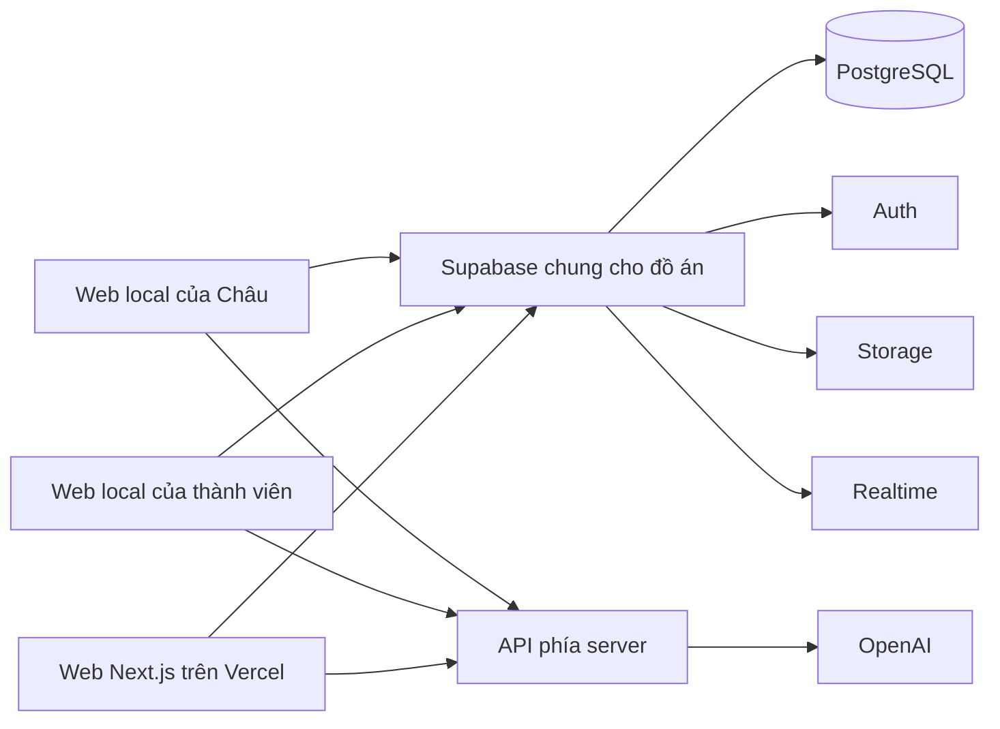

# Chuyển TCT English sang Vercel và Supabase

Ngày lập: 05/11/2026. **Đã hủy theo quyết định mới của Châu cùng ngày.** Giữ
ASP.NET Core/MariaDB và triển khai gói dữ liệu dùng chung; xem
[kế hoạch thay thế](../plans/2026-11-05-shared-data-packages.md).
Nội dung dưới đây chỉ là đề xuất lịch sử, chưa triển khai ứng dụng mới/chuyển
traffic; không dùng làm chỉ thị tạo project, đổi công nghệ hoặc dùng chung DB.

## Những yêu cầu Châu đã chốt

- Môn học cho phép đổi ngôn ngữ và công nghệ.
- Giữ toàn bộ chức năng hiện có; không thu gọn thành bản demo ít tính năng.
- Local của cả nhóm và web Vercel dùng chung **một Supabase** cho đồ án. Châu đã
  xác nhận thao tác thử từ local cũng thay đổi dữ liệu trên web báo cáo.
- Mục tiêu là đơn giản hóa việc chạy local, chia sẻ dữ liệu và đưa code lên web.
- Mốc báo cáo đã nêu trong chat là 25/11/2026; còn 20 ngày tại thời điểm lập.
- Đây không phải quyền xóa bản cũ, hủy hosting, nâng gói trả phí, đổi DNS ngay,
  reset dữ liệu hoặc đưa key/backup lên Git. Production Plesk vẫn giữ deploy OFF.

## Kiến trúc đề xuất

| Thành phần | Phương án |
| --- | --- |
| Ngôn ngữ ứng dụng | TypeScript |
| Web và API | Next.js App Router, React, Node.js runtime trên Vercel |
| Giao diện | Chuyển Razor thành React; giữ nhận diện và Bootstrap/CSS hiện có trước, không redesign đồng thời |
| Database | Supabase PostgreSQL dùng chung; migration SQL có phiên bản |
| Đăng nhập | Supabase Auth, profile/role tương thích tài khoản cũ |
| Tệp | Supabase Storage; phân quyền bucket/object theo nghiệp vụ |
| Chat/presence/cập nhật trực tiếp | Supabase Realtime, giữ kiểm tra quyền lớp/owner |
| AI text/audio | Giữ OpenAI và các quy tắc chấm/fallback/quota hiện có; chỉ gọi từ server |
| Công việc nền | Công việc có trạng thái trong Postgres, lịch/queue và worker có giới hạn thời gian |
| Git và phát hành | Feature branch/PR, kiểm tra bắt buộc, Vercel Preview; chỉ chuyển domain sau nghiệm thu |

Next.js là đề xuất kỹ thuật của agent, không phải yêu cầu framework do Châu nêu.
Phiên bản Node/Next/React/Supabase SDK và CLI sẽ được chọn theo tài liệu thực tế
khi bắt đầu triển khai, pin và lưu lockfile. Không tự nâng toolchain bản cũ.

Các server local và Vercel đều có API tương ứng; sơ đồ nhóm chúng để dễ đọc.
Key OpenAI/secret Supabase chỉ có ở server. Trình duyệt dùng publishable key và
session người dùng; RLS/kiểm tra API quyết định quyền, không tin role do client gửi.

## Cách nhóm làm việc sau khi chuyển xong

1. Pull code, cài dependency theo lockfile và thiết lập cấu hình local một lần.
2. Chạy web local bằng lệnh npm của dự án. Dùng Supabase hosted chung nên không
   cần Docker MariaDB/SSMS hay local ASR trong công việc thường ngày.
3. Thêm học liệu/lớp/bộ từ ở local hoặc trên Vercel ghi vào cùng DB/Storage.
   Thành viên khác thấy sau khi tải lại danh sách; realtime dùng ở nơi cần thiết.
4. Đưa thay đổi code qua PR để kiểm tra và deploy. Merge không cần chép rows DB.
5. Thay đổi bảng/cột vẫn dùng migration đã review do một luồng triển khai áp dụng.
   Không cho mỗi Agent tự reset, sửa schema hosted hoặc chạy test phá hủy dữ liệu.

Chung DB không đồng nghĩa chung tài khoản: lịch sử, Goals, draft và tiến độ vẫn
riêng; học liệu chung, lớp và chat theo đúng quyền hiện hành. Dữ liệu thử là dữ
liệu thật của project đồ án này. Các preview branch phải tương thích schema dùng
chung; ưu tiên migration bổ sung tương thích ngược, không drop cột đang sử dụng.

## Phạm vi chức năng phải có bằng chứng tương đương

| Nhóm | Hành vi phải giữ và kiểm tra |
| --- | --- |
| Account | Đăng ký/đăng nhập/đăng xuất, Google/Facebook, quên/đổi mật khẩu, profile/avatar, khóa/mở tài khoản, vai trò |
| Dashboard/public | Landing, dashboard, tìm kiếm, điều hướng và các URL cũ cần giữ |
| Vocabulary | Folder cây, bộ/thẻ, học liệu hệ thống, chia sẻ/lưu, tìm kiếm, ảnh, các chế độ học/ôn và tiến độ |
| Classes | Chủ lớp, thành viên, yêu cầu tham gia, blacklist, chia sẻ folder, quyền xem/sửa |
| Chat | Văn bản/ảnh, realtime, presence, mute, quyền tham gia lớp |
| Reading | Catalog, nội dung, câu hỏi/lựa chọn, lịch sử, dịch/vote, hoàn thành |
| Listening | Catalog, bài riêng, video/audio, transcript/time/speaker, quiz/vocab, import và tiến độ |
| Speaking | Playlist/video riêng/chung, phụ đề/import, shadowing/dictation, ghi âm, STT, đối chiếu/chấm, NoSpeech và retry |
| Writing | Catalog/bài riêng/generate, câu/đáp án được duyệt, Local/cloud feedback, NeedsReview, draft từng owner, lịch sử và tiến độ |
| Goals/rewards | Mục tiêu từng kỹ năng, streak, XP, huy hiệu, chống cộng trùng/replay và ngày nghiệp vụ |
| Notifications | Danh sách/số chưa đọc, read/read-all, ownership, outbox, lịch nhắc và chống gửi trùng |
| AI | Chat full/embed/class, streaming/cancel, lịch sử, context/retrievers, quota/rate limit/usage, fallback và observability |
| AI nội bộ | Intent classifier, dataset, train/evaluate/load model và quản trị; ML.NET phải có phương án TypeScript được chứng minh, không bỏ chức năng |
| Billing | Premium plans/quyền, VNPay/MoMo, chữ ký/callback/IPN, idempotency, subscriptions, admin/audit/reconciliation/expiry |
| Admin | Các màn hình đang hoạt động, lọc/phân trang/CRUD, concurrency/conflict, kiểm tra role phía server |
| Vận hành | Email, upload, lỗi/thông báo người dùng, jobs/retry, kiểm thử, secrets, deploy, backup và rollback |

Đây là checklist phạm vi, chưa phải kết luận đã kiểm kê đủ từng endpoint/mode.
Cần lập ma trận route/use-case/test cụ thể từ source và test cũ trong bước đầu.
32 file controller/worker và 60 bảng của staging cho thấy chuyển đổi này lớn hơn
việc chép frontend. Các test .NET cũ là tham chiếu nghiệp vụ, không tự chạy cho TS.

## Chuyển dữ liệu và danh tính

- Dùng snapshot đã sao lưu làm đầu vào riêng; xác nhận lần chốt dữ liệu trước
  nhập cuối. Staging đã chứa dữ liệu production cùng dữ liệu thử mới; không tự
  chọn dump production cũ làm nguồn duy nhất và làm mất thay đổi của nhóm.
- Chuyển MariaDB sang PostgreSQL có mapping kiểu/cột/identity/index/FK, timezone,
  Unicode/tiếng Việt, JSON và so sánh phân biệt hoa thường. Thử trên DB disposable.
- Giữ provenance/legacy IDs và bảng ánh xạ; Supabase Auth dùng danh tính riêng.
  Có thể giữ khóa ứng dụng cũ và thêm auth user mapping để giảm remap lịch sử.
- Di trú Auth riêng với database nghiệp vụ: hash BCrypt, tài khoản social và role
  phải có thử nghiệm thực. Không hứa giữ được mọi mật khẩu trước khi spike đạt;
  không đặt mật khẩu chung, đánh dấu email verified đại trà hoặc công khai hash.
- Session/cookie/reset token cũ không được xem là session hợp lệ của hệ thống mới.
- Role không lấy từ user_metadata do người dùng sửa được. Quyền Admin phải do
  server/metadata được bảo vệ quyết định; kiểm cả API và RLS/Storage policies.
- Các bảng/field legacy và EF history được bảo toàn trong provenance/archive phù
  hợp, không biến EF history thành Supabase migration history hoặc expose auth data.
- Đối chiếu row counts, dữ liệu con, orphan, hash nội dung và quyền sau nhập;
  chạy lại importer không nhân đôi, không overwrite edits chưa được duyệt.
- Media dùng manifest/hash và Storage mapping. 27 tệp/7.794.316 bytes đã tìm thấy
  ở hosting có thể di trú. 94 đường dẫn thiếu ngay ở nguồn phải giữ trong báo cáo;
  đổi nền tảng không khôi phục được các tệp đó.

## Những spike phải đạt trước khi nhận định toàn bộ phạm vi khả thi đúng hạn

1. Auth: một tài khoản BCrypt thật được nhập có kiểm soát, login/role/owner cùng
   2 tài khoản kiểm chống truy cập chéo; xác minh Google/Facebook redirect.
2. Database: nhập thử đủ snapshot, đối chiếu quan hệ và kiểu dữ liệu; không ghi
   vào MariaDB đang chạy và không reset project hosted dùng chung.
3. Speaking/Listening import: trình phát, captions/SRT/VTT, STT ngắn; import audio
   dài/native FFmpeg và retry/chunk queue phải phù hợp thời gian/CPU/payload thực tế.
   Không bê BackgroundService vòng lặp sang một request hoặc chạy nhiều worker local.
4. ML.NET: xác định khả năng chuyển model hoặc huấn luyện/runtime TypeScript tương
   đương; giữ UI/dataset/metrics/intent routing và fallback, không thay bằng nút giả.
5. Jobs: lease/checkpoint/idempotency cho notifications, credits và payments khi
   local/preview cùng dùng DB; chỉ một scheduler được phép thực thi lịch hosted.
6. Email/payment: cấu hình test/callback/sandbox riêng và chứng minh luồng thật;
   không thay VNPay/MoMo thành provider khác hoặc gọi mock là nghiệm thu đầy đủ.

## Các giai đoạn chuyển đổi

1. **Kiểm kê và thử những phần khó:** ma trận đầy đủ, dữ liệu, Auth, worker/import,
   ML.NET, giới hạn nền tảng. Ghi blocker và thời gian thực tế.
2. **Nền tảng mới chạy riêng:** nhánh feature/vercel-supabase-migration; Next.js,
   Supabase migrations/RLS/Auth/Storage, cấu hình local/CI, rule của bốn công cụ.
   Chọn checkout phù hợp và giữ nguyên mọi thay đổi chưa commit đang có.
3. **Chuyển các nhóm nghiệp vụ:** accounts → vocabulary/classes/chat → kỹ năng
   học → goals/notifications → AI/Admin/Billing/jobs, theo phụ thuộc và kiểm thử.
4. **Nhập dữ liệu và nghiệm thu đầy đủ:** ba role, hai người dùng, browser desktop/
   mobile, files, lỗi provider, callbacks, worker retries, bảo toàn và backup/restore.
5. **Chuyển web báo cáo:** chỉ khi ma trận đạt, backup mới, xác nhận điểm chốt dữ
   liệu, cấu hình domain/DNS/callback, kiểm TLS và giữ bản Plesk để quay lại.

Các giai đoạn là kế hoạch thứ tự, không phải cam kết xong 100% trước 25/11.
Không dựng UI rỗng cho các mục chưa port hoặc giảm scope mà không báo Châu.
Chỉ gọi hoàn tất khi từng nhóm có bằng chứng; thiếu API key/SMTP/payment test
hoặc tài nguyên hosted phải ghi đúng blocker, không gọi skipped là pass.

## Tài khoản và chi phí

Đã đọc được danh sách project qua plugin Supabase và Vercel của Châu; chưa tạo
project mới, thay gói, bật dịch vụ trả phí, đọc secret hoặc upload dữ liệu lên đó.
Chưa thấy project TCT English mới được xác định. Ưu tiên project riêng, khu vực
gần nhóm, không dùng chung database với các đồ án khác trong tài khoản.

Snapshot hiện nhỏ hơn quota dung lượng Free công khai, nhưng không phải bằng
chứng chịu tải hoặc bảo đảm mọi tính năng miễn phí. Supabase Free có giới hạn
project và có thể pause khi ít hoạt động; cần kiểm tra trước buổi báo cáo. Email,
AI, thời lượng import/jobs và quota Vercel cần đánh giá riêng. Không nâng gói khi
chưa có ngân sách được Châu cho phép. Git collaborator/preview phải thử với repo
và tài khoản Vercel thật, không hứa PR của cả nhóm tự deploy chỉ từ việc nối Git.

## Tài liệu chính thức đã đối chiếu

- [Next.js trên Vercel](https://vercel.com/docs/frameworks/full-stack/nextjs)
- [Vercel Git deployments và cộng tác](https://vercel.com/docs/git)
- [MySQL → Supabase PostgreSQL](https://supabase.com/kb/guides/migrate-from-mysql)
- [RLS](https://supabase.com/docs/guides/database/postgres/row-level-security)
- [Auth password security](https://supabase.com/docs/guides/auth/password-security)
- [Realtime](https://supabase.com/docs/guides/realtime)
- [Storage](https://supabase.com/docs/guides/storage)
- [Supabase pricing](https://supabase.com/pricing)
- [Free project pausing](https://supabase.com/docs/guides/platform/free-project-pausing)
- [Supabase CLI v3 breaking change04/11](https://supabase.com/changelog/supabase-cli-v3)

Nếu dùng CLI v3, đọc help/version và target hosted tường minh; không sao chép các
lệnh CLI v2 cũ theo trí nhớ. Không thực hiện lệnh provisioning/migration trong tài
liệu thiết kế này.
