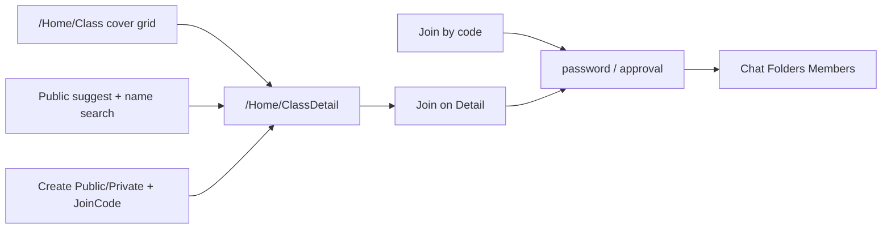

# Virtual Classroom redesign — design

Date: 2026-11-23. Owner-locked decisions from planning chat.

## Outcome

Teacher-first Virtual Classroom: membership, shared folders, SignalR chat. Cover-card Clay UI on My Classes and pre-join Detail. Join only from Class Detail. Server enforces mute, chat lock, and `AllowMemberToPost`. Chat history supports load-more.

## Product rules

- Center role: class Owner / Assistant management before learner chat.
- Single Detail page (approach 3). Managers default to Requests (if pending) else Folders; Chat is not the default.
- Assistant cannot remove folders they did not add (Owner/Admin/adder only).
- Find/list opens Detail; Join on Detail or via **join code** on `/Home/Class` (password/approval still apply when enabled).
- Cover-card grid on entire `/Home/Class` (managed + joined) and Public discovery results. Pre-join Detail uses large cover hero.
- **Public/Private**: Public appears in discovery/search; Private does not. Every class has a unique **JoinCode** (generate/regenerate; copy on create success + Detail for managers).
- No price, no Academos star/price row. Clay `--tct-*` only.
- Cover image reuses `Class.ImageUrl` via `ImageUploadPolicies.ClassImage` (landscape cover UX, not round avatar).
- Out of scope: video classroom, Admin ClassManagement/MessageManagement 404 backlog.

## Flows

## Correctness fixes

- `ClassChatHub` SendMessage/SendImageMessage enforce `IsMuted` and `IsChatLocked`.
- `AddFolderToClassAsync` enforces `AllowMemberToPost` for plain members.
- Join requiring approval returns success with `status: pending` (not BadRequest).
- Detail ViewModel exposes `IsMutedForCurrentUser` and `CanSendChat`.
- Client escapes chat/search HTML; find-class copy does not claim an invite code.

## UX surfaces

| Surface | Behavior |
| --- | --- |
| My Classes | Sections Managed then Joined; 3→2→1 cover grid; badges only |
| Find / discover | Public suggest on load + name search; join-by-code button; cover cards → Detail |
| Join code | All classes; managers copy/regenerate; create success card shows code |
| Create/Edit | Ảnh bìa lớp landscape preview; three plain-language toggles |
| Pre-join Detail | Cover hero + description + badges + Tham gia nhóm |
| Joined Detail | Management-first tabs for managers; composer respects CanSendChat |
| Chat | Latest N messages + Tải thêm older page |

## Multi-platform

Desktop and mobile in the same change set per [2026-11-09-multi-platform-ui-design.md](2026-11-09-multi-platform-ui-design.md). Evidence at ~1440, 768, 375/390.

## Schema

`Classes.IsPublic` (default true) and `Classes.JoinCode` (unique). Existing rows backfilled Public + synthetic codes.
