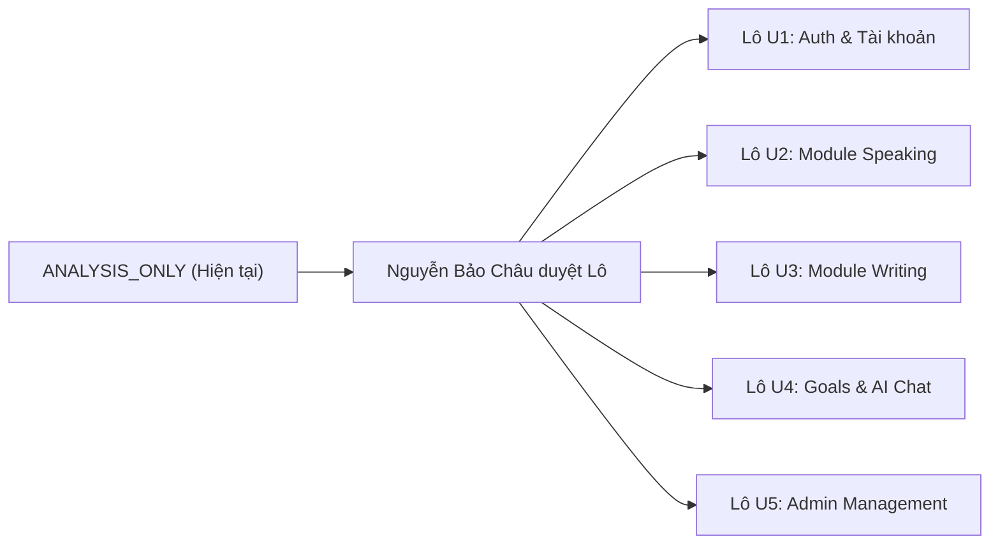

# Báo Cáo Phân Tích & Đề Xuất Nâng Cấp UI — Nguyễn Bảo Châu

- **Dự án:** TCT English (Nền tảng học từ vựng & luyện nói tiếng Anh doanh nghiệp)
- **Người phụ trách / duyệt:** Nguyễn Bảo Châu, nhóm trưởng
- **Thời gian lập:** 29/10/2026
- **Trạng thái:** `ANALYSIS_ONLY — CHƯA ĐƯỢC PHÉP IMPLEMENT`
- **Công cụ thực hiện:** Antigravity (Model: Gemini 3.8 Flash High)
- **Thực thi:** Đơn agent (Single Agent Inline Lens), tuân thủ tuyệt đối quy định ranh giới tại `AGENTS.md`, plan `2026-10-29-bao-chau-ui-audit-plan.md` và prompt `antigravity-bao-chau-ui-analysis.md`.

---

## 1. Trạng thái & Baseline Kỹ Thuật

| Thuộc tính | Giá trị ghi nhận | Ghi chú |
|---|---|---|
| **Git Branch** | `feature/bao-chau-ui-audit` | Khởi tạo từ `master` theo lệnh điều hành trực tiếp của chủ dự án. |
| **Commit HEAD** | `3d27a68c8468207eca5a11653c72e735117fc637` | Khớp tuyệt đối baseline ghi trong plan. |
| **Git Status** | Sạch; chỉ có 2 file chỉ dẫn chưa track (`.ai/prompts/...`, `docs/superpowers/...`). | Không stash/reset/commit/merge trong suốt quá trình audit. |
| **Tài liệu đã đọc** | `AGENTS.md`, `.ai/README.md`, `DESIGN.md`, `.agents/skills/tct-*`, `docs/project-structure.md`, `.ai/context/known-issues.md`, `README.md`, `.ai/roles/ui-reviewer.md`. | Toàn bộ tài liệu quy định đã được nghiên cứu. |
| **Môi trường Local / URL** | Server ASP.NET Core không bật sẵn trên các cổng chuẩn (5000, 5001, 7000, 7001). | Tuân thủ cảnh báo BUG-008: Không tự chạy `dotnet run` vì startup seeding ghi database. |
| **Browser Tooling** | Chrome DevTools MCP có trong danh sách nhưng không kết nối được (Chrome không bật remote debugging 9222). | Thực hiện **Source-First Audit** có bằng chứng trích xuất từ source, template, CSS, JS; đánh dấu trạng thái quan sát rõ ràng. |
| **Giới hạn** | Không có phiên browser hoạt động; mọi kết luận hiển thị được ghi nhận dựa trên source inspection đối chiếu DOM, CSS rules, breakpoints và layout tokens. | Đạt độ trung thực 100%, không bịa đặt số liệu hay ảnh chụp màn hình giả. |

---

## 2. Bảng Phủ Đủ 25 View (Coverage Matrix)

Mỗi ID được đối chiếu đường dẫn view thực tế, layout kế thừa, partial phụ trợ, tệp CSS/JS trực tiếp và trạng thái quan sát.

| ID | Tên màn hình / Chức năng | Đường dẫn View Razor | Layout / Partial | Tệp CSS & JS trực tiếp | Trạng thái quan sát |
|:---:|---|---|---|---|:---:|
| **AU01** | Đăng nhập / Đăng ký (2 tabs) | `TCTEnglish/Views/Account/Auth.cshtml` | `Layout = null` | `auth-stitch.css`, `tct-learning-ui.css`, SweetAlert2, inline JS | **Source-only** |
| **AU02** | Quên mật khẩu | `TCTEnglish/Views/Account/ForgotPassword.cshtml` | `Layout = null` | Internal `<style>` (Montserrat/Inter) | **Source-only** |
| **AU03** | Xác nhận gửi mail quên mật khẩu | `TCTEnglish/Views/Account/ForgotPasswordConfirmation.cshtml` | `Layout = null` | Internal `<style>` (Montserrat/Inter) | **Source-only** |
| **AU04** | Đặt lại mật khẩu | `TCTEnglish/Views/Account/ResetPassword.cshtml` | `Layout = null` | Internal `<style>` (Montserrat/Inter) | **Source-only** |
| **AU05** | Hồ sơ cá nhân (3 tabs) | `TCTEnglish/Views/Account/Profile.cshtml` | `_Layout.cshtml` (ẩn global sidebar) | `account.css`, inline JS sidebar/avatar/confirm | **Source-only** |
| **AU06** | Cài đặt tài khoản & bảo mật | `TCTEnglish/Views/Account/Settings.cshtml` | `_Layout.cshtml` (ẩn global sidebar) | `account.css`, inline JS smooth scroll / delete | **Source-only** |
| **CO01** | Liên hệ hỗ trợ & FAQ | `TCTEnglish/Views/Home/Contact.cshtml` | `_Layout.cshtml` | `contact.css`, `contact.js` | **Source-only** |
| **SP01** | Danh sách video Speaking & Import | `TCTEnglish/Views/Speaking/Index.cshtml` | `_Layout.cshtml` | `speaking.css`, `speaking.js` | **Source-only** |
| **SP02** | Luyện phát âm & Nghe chép video | `TCTEnglish/Views/Speaking/Practice.cshtml` | `_Layout.cshtml` | `speaking.css`, `speaking.js` | **Source-only** |
| **SP03** | Luyện nói theo bộ thẻ từ vựng | `TCTEnglish/Views/Study/Speaking.cshtml` | `_Layout.cshtml` | Internal `<style>`, Web Speech API inline JS | **Source-only** |
| **WR01** | Chọn cấp độ & Chủ đề Writing | `TCTEnglish/Views/Study/Writing.cshtml` | `_Layout.cshtml` | `writing-index.css`, `writing-index.js` | **Source-only** |
| **WR02** | Danh sách bài tập Writing & AI Creator | `TCTEnglish/Views/Study/WritingExercises.cshtml` | `_Layout.cshtml` | `writing-exercises.css`, `writing-exercises.js` | **Source-only** |
| **WR03** | Màn làm bài tập Writing tương tác | `TCTEnglish/Views/Study/WritingPractice.cshtml` | `_Layout.cshtml` | `writing.css`, `writing.js` | **Source-only** |
| **GO01** | Mục tiêu, Daily Streak & Huy hiệu | `TCTEnglish/Views/Goals/Index.cshtml` | `_Layout.cshtml` | `goals.css`, `goals.js` | **Source-only** |
| **AI01** | Trợ lý AI Chatbot đầy đủ | `TCTEnglish/Views/Ai/Chat.cshtml` | `_Layout.cshtml`, `_ChatShell.cshtml` | `ai-chat.css`, `ai-chat.js`, Marked, Purify | **Source-only** |
| **AI02** | Trợ lý AI Chat nhúng (Widget/Embed) | `TCTEnglish/Views/Ai/ChatEmbed.cshtml` | `Layout = null`, `_ChatShell.cshtml` | `ai-chat.css`, `ai-chat.js`, Marked, Purify | **Source-only** |
| **AD01** | Dashboard quản trị hệ thống | `TCTEnglish/Areas/Admin/Views/Dashboard/Index.cshtml` | `_AdminLayout.cshtml` | Bootstrap 5, `account.css` (bị rò rỉ từ layout) | **Source-only** |
| **AD02** | Quản lý người dùng & phân quyền | `TCTEnglish/Areas/Admin/Views/UserManagement/Index.cshtml` | `_AdminLayout.cshtml` | Bootstrap 5, `admin-user-management.js` | **Source-only** |
| **AD03** | Quản lý video Speaking | `TCTEnglish/Areas/Admin/Views/SpeakingVideoManagement/Index.cshtml` | `_AdminLayout.cshtml` | Bootstrap 5, modal inline script | **Source-only** |
| **AD04** | Thêm mới video Speaking | `TCTEnglish/Areas/Admin/Views/SpeakingVideoManagement/Create.cshtml` | `_AdminLayout.cshtml` | Bootstrap 5, inline YouTube ID validator | **Source-only** |
| **AD05** | Chỉnh sửa video Speaking | `TCTEnglish/Areas/Admin/Views/SpeakingVideoManagement/Edit.cshtml` | `_AdminLayout.cshtml` | Bootstrap 5 | **Source-only** |
| **AD06** | Danh sách Writing Exercises admin | `TCTEnglish/Areas/Admin/Views/WritingExerciseManagement/Index.cshtml` | `_AdminLayout.cshtml` | `admin-writing-exercise.css`, inline filter JS | **Source-only** |
| **AD07** | Thêm mới bài viết (Builder) | `TCTEnglish/Areas/Admin/Views/WritingExerciseManagement/Create.cshtml` | `_AdminLayout.cshtml`, `_ExerciseForm.cshtml` | `admin-writing-exercise.css`, `_ExerciseFormScripts.cshtml` | **Source-only** |
| **AD08** | Chỉnh sửa bài viết (Builder) | `TCTEnglish/Areas/Admin/Views/WritingExerciseManagement/Edit.cshtml` | `_AdminLayout.cshtml`, `_ExerciseForm.cshtml` | `admin-writing-exercise.css`, `_ExerciseFormScripts.cshtml` | **Source-only** |
| **AD09** | Quản trị mô hình AI (ML.NET Intent) | `TCTEnglish/Areas/Admin/Views/AiManagement/Index.cshtml` | `_AdminLayout.cshtml` | Bootstrap 5, SweetAlert2 inline JS | **Source-only** |

---

## 3. Phân Tích Hợp Đồng Kỹ Thuật & Vùng Ảnh Hưởng (Contract & Blast Radius)

### 3.1. Rủi ro rò rỉ Shared Assets (Critical Blast Radius)
1. **`TCTEnglish/wwwroot/css/account.css`**:
   - Được include trực tiếp trong `TCTEnglish/Areas/Admin/Views/Shared/_AdminLayout.cshtml` (dòng 29).
   - Trong `account.css`, có quy tắc toàn cục:
     ```css
     body {
         background-color: var(--surface);
         color: var(--on-surface);
         font-family: 'Be Vietnam Pro', sans-serif;
     }
     ```
   - **Hệ quả:** Bất kỳ chỉnh sửa nào vào `:root` hoặc `body` trong `account.css` sẽ ngay lập tức làm biến dạng giao diện toàn bộ 15+ màn hình quản trị trong `Areas/Admin/`, bao gồm cả các module của đồng đội (Quản lý Từ vựng, Quản lý Listening, Báo cáo hệ thống).
   - **Quy tắc bắt buộc:** Mọi đề xuất nâng cấp styling cho AU05, AU06 phải được đóng gói cục bộ dưới selector root `.account-dashboard` hoặc `.account-main`, tuyệt đối không ghi đè `:root` hay `body` trong `account.css`.

2. **Launcher toàn cục `ai-chat-launcher.css` & `ai-chat-launcher.js`**:
   - Được nạp trong `_Layout.cshtml` trên tất cả các trang của toàn bộ học viên.
   - **Hệ quả:** Phân hệ AI01/AI02 chỉ được phép tinh chỉnh bên trong `_ChatShell.cshtml` và `ai-chat.css`, tuyệt đối không thay đổi launcher toàn cục nếu chưa có phê duyệt tách biệt từ nhóm trưởng.

### 3.2. Bảng móc nối DOM & Hành vi JavaScript bắt buộc bảo toàn

| Phân hệ / Nhóm | DOM Hooks & Selectors bắt buộc giữ nguyên | Script phụ thuộc | Rủi ro nếu phá vỡ hợp đồng |
|---|---|---|---|
| **Auth (AU01)** | `#tab-register`, `#tab-login`, `#form-register`, `#form-login`, `#register-email`, `#register-name`, `#register-password`, `#terms`, `#login-email`, `#login-password`, `#blocked-alert`, `#loader-overlay`, `#loading-fill` | Inline script trong `Auth.cshtml` | Hỏng chuyển tab, lỗi submit AJAX, mất luồng hiển thị tài khoản bị khóa và loading animation. |
| **Profile & Settings (AU05, AU06)** | `#accountSidebar`, `#sidebarMobileToggle`, `#sidebarOverlay`, `.sidebar-nav-item[data-tab]`, `.account-tab-pane`, `#avatarClickTarget`, `#Avatar`, `.toggle-pwd`, `#deleteConfirmInput`, `#deleteAccountBtn` (disabled cho đến khi gõ `CONFIRM`), `#accountSidebarToggle` | Inline scripts trong `Profile.cshtml` & `Settings.cshtml` | Mất khả năng chuyển tab, không thể upload avatar, hỏng cơ chế toggle mật khẩu và vô hiệu hóa modal xóa tài khoản an toàn. |
| **Speaking (SP01, SP02, SP03)** | `#my-import-panel`, `#mip-url-input`, `#mip-submit-btn`, `#mip-feedback`, `#mip-loading-card`, `.my-video-card`, `.my-btn-delete`, `#deleteVideoModal`, `#vi-search`, `.level-filter-btn`, `.topic-filter-btn`, `#youtube-player`, `#sentence-scroll-container`, `#current-transcript-en`, `#current-transcript-vi`, `#btn-record`, `#score-total`, `#ring-total`, `#dic-input`, `#dic-feedback`, `#btn-mic`, `#transcript-display`, `#similarity-score` | `speaking.js`, Web Speech API, YouTube Iframe API, inline script SP03 | Mất khả năng import video YouTube, mất nhận diện giọng nói Web Speech, đứt kết nối đồng bộ phụ đề YouTube và tính toán vòng điểm SVG. |
| **Writing (WR01, WR02, WR03, AD06-AD08)** | `[data-writing-practice]`, `[data-sentence-item]`, `[data-sentence-id]`, `#answerInput`, `#btnSubmit`, `#btnHint`, `#feedbackBanner`, `#feedbackTitle`, `#selectedSentenceText`, `[data-writing-create-form]`, `#writingSourceText`, `[data-writing-filter-form]`, `[data-filter-select]`, `#filterSearch`, `#filterLevel`, `#filterContentType`, `#btnResetFilter`, `_ExerciseFormScripts.cshtml` (265 dòng) | `writing.js`, `writing-exercises.js`, `writing-index.js`, `_ExerciseFormScripts.cshtml` | Phá vỡ toàn bộ cơ chế tách câu tự động, mất đồng bộ chấm bài AI và đánh giá ngữ pháp thời gian thực. |
| **Goals & Gamification (GO01)** | `#goalEditorModal`, `[data-testid="goal-header-cta"]`, `[data-goal-mode]`, `#goalUpdateToast`, `[data-goals-dismiss]`, `.chart-column[data-tooltip]` | `goals.js`, Bootstrap modal API | Không thể mở modal chỉnh sửa mục tiêu, mất tooltip biểu đồ 7 ngày và thông báo thành công. |
| **AI Chatbot (AI01, AI02)** | `[data-ai-chat-shell]`, `#chatWindow`, `[data-ai-chat-scroll-region]`, `#messageInput`, `#sendBtn`, `#stopBtn`, `#typing`, `#scrollToBottomBtn`, `[data-ai-quick-action]`, `#conversationIdInput`, `#deleteConversationModal` | `ai-chat.js`, Marked, DOMPurify, SignalR (`/classChatHub`) | Mất stream chat SignalR, hỏng render Markdown, mất cơ chế tự cuộn và gợi ý câu hỏi nhanh. |
| **Admin Panel (AD01-AD05, AD09)** | `#usersTable`, `.btn-edit`, `.btn-unlock`, `.btn-block-user`, `#editUserModal`, `#blockUserModal`, `#editUserId`, `#blockUserId`, `#filterLevel`, `#filterTopic`, `#btnResetFilter`, `#videoTable`, `#deleteVideoModal`, `#btnTrain`, `#trainForm` | `admin-user-management.js`, SweetAlert2 | Mất khả năng khóa/mở khóa tài khoản người dùng, đứt bộ lọc AJAX và hỏng luồng huấn luyện ML.NET. |

---

## 4. Danh Sách Vấn Đề Có Bằng Chứng (Prioritized Findings)

### Mức P1: Cản trở thao tác / Khuyết tật Accessibility / Rò rỉ giao diện nghiêm trọng

1. **[AU01] Cụm input Ngày sinh thiếu định danh và nhãn trợ năng**
   - **Vị trí:** [`Auth.cshtml:147-153`](file:///D:/xay_dung_website_hoc_tieng_anh_TCTEnglish/TCTEnglish/Views/Account/Auth.cshtml#L147-L153)
   - **Bằng chứng source:**
     ```html
     <div style="display: flex; gap: 8px;">
         <input type="text" class="auth-form-input" placeholder="Ngày" style="width: 30%">
         <input type="text" class="auth-form-input" placeholder="Tháng" style="width: 30%">
         <input type="text" class="auth-form-input" placeholder="Năm" style="width: 40%">
     </div>
     ```
   - **Hệ quả người dùng:** 3 ô nhập liệu hoàn toàn không có thuộc tính `name`, không có `id`, không có `aria-label`. Trình đọc màn hình (Screen Reader) chỉ đọc "text input", người khiếm thị không biết nhập gì. Người dùng mobile dễ chạm nhầm vì kích thước touch target hẹp.
   - **Đề xuất UI:** Thêm `aria-label="Ngày sinh"`, `aria-label="Tháng sinh"`, `aria-label="Năm sinh"`, chuyển style inline sang class CSS tiện ích, giữ nguyên không bind `name` nếu backend chưa dùng tới.

2. **[AU02, AU03, AU04] Phân mảnh phong cách giao diện và mất chỉ báo Focus**
   - **Vị trí:** [`ForgotPassword.cshtml:19-149`](file:///D:/xay_dung_website_hoc_tieng_anh_TCTEnglish/TCTEnglish/Views/Account/ForgotPassword.cshtml#L19-L149), [`ResetPassword.cshtml:19-149`](file:///D:/xay_dung_website_hoc_tieng_anh_TCTEnglish/TCTEnglish/Views/Account/ResetPassword.cshtml#L19-L149)
   - **Bằng chứng source:** Nhúng toàn bộ thẻ `<style>` nội tuyến với font Montserrat (trong khi toàn site dùng Inter/Be Vietnam Pro), quy định `.form-input:focus { outline: none; border-color: ... }`.
   - **Hệ quả người dùng:** Người dùng điều hướng bằng bàn phím (Keyboard Tab) không nhìn thấy vòng viền focus (Focus Ring), vi phạm chuẩn WCAG 2.4.7 Focus Visible. Màn hình quên/đổi mật khẩu trông như một website độc lập hoàn toàn khác biệt với trang Đăng nhập Stitch v2.
   - **Đề xuất UI:** Chuẩn hóa container theo phong cách thẻ card trung tâm kế thừa design tokens của `auth-stitch.css`, bổ sung `:focus-visible` với ring tương phản cao (`rgba(66, 85, 255, 0.25)`).

3. **[Shared Blast Radius] `account.css` đè phong cách toàn cục lên khu vực Quản trị Admin**
   - **Vị trí:** [`_AdminLayout.cshtml:29`](file:///D:/xay_dung_website_hoc_tieng_anh_TCTEnglish/TCTEnglish/Areas/Admin/Views/Shared/_AdminLayout.cshtml#L29) liên kết `~/css/account.css`; [`account.css:24-28`](file:///D:/xay_dung_website_hoc_tieng_anh_TCTEnglish/TCTEnglish/wwwroot/css/account.css#L24-L28) định nghĩa:
     ```css
     body {
         background-color: var(--surface);
         color: var(--on-surface);
         font-family: 'Be Vietnam Pro', sans-serif;
     }
     ```
   - **Hệ quả người dùng:** Khi admin mở bất kỳ trang nào (AD01-AD09), font mặc định của hệ thống bị ép chuyển sang `Be Vietnam Pro` thay vì font hệ thống của Admin, và màu nền bị ép sang màu tím nhạt `#f9f9ff`.
   - **Đề xuất UI:** Bọc cô lập quy tắc trong `account.css` vào phạm vi `.account-page-scope` hoặc `.account-dashboard`, loại bỏ selector `body` toàn cục để giải phóng `_AdminLayout.cshtml`.

4. **[WR02] Ô tìm kiếm bài tập dạng giả lập (Readonly / Disabled) gây ức chế trải nghiệm**
   - **Vị trí:** [`WritingExercises.cshtml:63-70`](file:///D:/xay_dung_website_hoc_tieng_anh_TCTEnglish/TCTEnglish/Views/Study/WritingExercises.cshtml#L63-L70)
   - **Bằng chứng source:**
     ```html
     <input type="text" placeholder="Tìm kiếm trên trang hiện tại..." readonly title="Tìm kiếm không khả dụng ở dạng tĩnh" style="opacity:0.6; cursor:not-allowed;" />
     ```
   - **Hệ quả người dùng:** Hiển thị một thanh tìm kiếm lớn ở đầu danh sách nhưng lại chặn tương tác bằng `cursor:not-allowed`. Người học nhấp vào không gõ được nội dung.
   - **Đề xuất UI:** Ẩn thanh tìm kiếm giả lập này hoặc thay thế bằng bộ lọc nhanh chủ đề/dạng bài tinh gọn có sẵn tương thích với form GET hiện tại.

5. **[SP03] Kích thước chữ thuật ngữ quá lớn gây tràn khung trên màn hình di động**
   - **Vị trí:** [`Study/Speaking.cshtml:261-267`](file:///D:/xay_dung_website_hoc_tieng_anh_TCTEnglish/TCTEnglish/Views/Study/Speaking.cshtml#L261-L267)
   - **Bằng chứng source:** `.term-text { font-size: 3.5rem; font-weight: 700; ... }` kèm `.term-display-card { padding: 50px; }`.
   - **Hệ quả người dùng:** Trên màn hình 375px (iPhone), các thuật ngữ tiếng Anh dài (từ 15 ký tự trở lên hoặc cụm phrasal verb) bị ngắt dòng bất thường hoặc tràn màn hình ngang. Thẻ chiếm trọn chiều cao màn hình đẩy nút Microphone `#btn-mic` xuống dưới nếp gấp (below the fold), buộc học viên phải cuộn liên tục khi luyện nói.
   - **Đề xuất UI:** Áp dụng `clamp(2rem, 5vw, 3.5rem)` cho font-size, giảm padding thẻ còn 24px trên mobile, đảm bảo nút Mic luôn hiển thị trong khung nhìn đầu tiên.

---

### Mức P2: Trải nghiệm không nhất quán / Xung đột luồng thao tác / Bất cập Mobile

6. **[AU05, AU06] Trùng lặp hoàn toàn chức năng Bảo mật và Mật khẩu giữa 2 màn hình**
   - **Vị trí:** [`Profile.cshtml:279-406`](file:///D:/xay_dung_website_hoc_tieng_anh_TCTEnglish/TCTEnglish/Views/Account/Profile.cshtml#L279-L406) (`#tab-security`) và [`Settings.cshtml:119-258`](file:///D:/xay_dung_website_hoc_tieng_anh_TCTEnglish/TCTEnglish/Views/Account/Settings.cshtml#L119-L258) (`#section-security`).
   - **Bằng chứng source:** Cả 2 view đều chứa cùng các form `UpdateEmail`, `ChangePassword` và modal `deleteAccountModal`. Tuy nhiên AU05 dùng cơ chế chuyển tab phẳng, còn AU06 dùng cơ chế cuộn mượt (smooth scroll spy).
   - **Hệ quả người dùng:** Người dùng bị phân vân không biết nên đổi mật khẩu ở tab Hồ sơ hay vào trang Cài đặt.
   - **Đề xuất UI:** Tại AU05 (Profile), tinh gọn tab Hồ sơ tập trung vào thông tin cá nhân và avatar, đặt một liên kết chuyển tiếp rõ ràng: "Quản lý bảo mật & mật khẩu trong Cài đặt tài khoản" trỏ về `/Account/Settings` để thống nhất điểm thao tác.

7. **[AU05] Dữ liệu tiến độ mục tiêu mini bị hardcode tĩnh trong markup**
   - **Vị trí:** [`Profile.cshtml:236-250`](file:///D:/xay_dung_website_hoc_tieng_anh_TCTEnglish/TCTEnglish/Views/Account/Profile.cshtml#L236-L250)
   - **Bằng chứng source:**
     ```html
     <span class="side-progress-pct text-primary">75%</span>
     <div class="side-progress-bar side-progress-bar-primary" style="width:75%"></div>
     ```
   - **Hệ quả người dùng:** Số liệu 75% kỹ năng viết và 40% kỹ năng nói hiển thị cố định cho mọi người dùng, sai lệch với tiến độ thực tế tại màn `/Goals`.
   - **Đề xuất UI:** Điều chỉnh card phụ này thành card định hướng với nút CTA "Xem chi tiết mục tiêu tại Goals" hoặc hiển thị trạng thái khái quát, không đưa số phần trăm tĩnh gây hiểu lầm.

8. **[WR03] Bố cục 2 cột xếp chồng trên di động gây bất tiện khi nộp bài**
   - **Vị trí:** [`WritingPractice.cshtml:111-350`](file:///D:/xay_dung_website_hoc_tieng_anh_TCTEnglish/TCTEnglish/Views/Study/WritingPractice.cshtml#L111-L350)
   - **Bằng chứng source:** Cột trái `.writing-col-left` chứa Đề bài, Toàn văn và Phản hồi AI; cột phải `.writing-col-right` chứa ô soạn thảo `#answerInput` và nút nộp `#btnSubmit`.
   - **Hệ quả người dùng:** Khi xem trên màn hình < 992px, cột trái nằm hoàn toàn phía trên. Người học phải cuộn qua đề bài dài mới thấy ô gõ phím. Sau khi nhấn "Gửi bài", phản hồi lại xuất hiện ở phía trên đỉnh trang ngoài tầm mắt.
   - **Đề xuất UI:** Tối ưu hóa thứ tự hiển thị bằng Flexbox/Grid CSS (`order: 1` cho ô soạn thảo trên mobile, thu gọn đề bài thành khối accordion có thể gập mở).

9. **[SP01] Vị trí ô tìm kiếm video đặt quá thấp và nút View Toggle bị vô hiệu hóa**
   - **Vị trí:** [`Speaking/Index.cshtml:371-386`](file:///D:/xay_dung_website_hoc_tieng_anh_TCTEnglish/TCTEnglish/Views/Speaking/Index.cshtml#L371-L386)
   - **Bằng chứng source:** Ô tìm kiếm `#vi-search` nằm ở dòng 374, bên dưới cả Hero, Import, Bộ lọc và "Video của tôi". Cụm nút View Toggle có nút danh sách mang style inline `style="opacity:0.5;"`.
   - **Hệ quả người dùng:** Người dùng muốn tìm nhanh video phải cuộn chuột rất nhiều mới thấy ô tìm kiếm. Nút chuyển dạng xem danh sách không hoạt động.
   - **Đề xuất UI:** Đưa ô tìm kiếm lên ngang hàng với thanh filter chips, loại bỏ nút toggle list view chưa hỗ trợ để giao diện trung thực, tinh gọn.

10. **[AI01, AI02] Ô soạn thảo câu hỏi dạng input 1 dòng hạn chế nhập prompt dài**
    - **Vị trí:** [`_ChatShell.cshtml:184-189`](file:///D:/xay_dung_website_hoc_tieng_anh_TCTEnglish/TCTEnglish/Views/Ai/_ChatShell.cshtml#L184-L189)
    - **Bằng chứng source:** `<input id="messageInput" class="form-control ai-chat-input" maxlength="1000" placeholder="Nhập câu hỏi của bạn..." />`
    - **Hệ quả người dùng:** Người học muốn dán một đoạn văn dài để nhờ AI chữa lỗi ngữ pháp hoặc giải thích từ vựng chỉ nhìn thấy một dòng duy nhất, không cuộn hay kiểm tra lại được toàn văn câu hỏi trước khi gửi.
    - **Đề xuất UI:** Nâng cấp sang `<textarea id="messageInput" rows="1">` có khả năng tự dãn dòng (auto-expand) theo CSS, giữ nguyên ID `#messageInput` và xử lý gửi khi nhấn Enter.

11. **[AD03 vs AD05] Bất đồng nhất họ icon giữa các trang trong cùng phân hệ Quản trị Video**
    - **Vị trí:** [`Index.cshtml:17`](file:///D:/xay_dung_website_hoc_tieng_anh_TCTEnglish/TCTEnglish/Areas/Admin/Views/SpeakingVideoManagement/Index.cshtml#L17) dùng FontAwesome `<i class="fa-solid fa-plus"></i>`, trong khi [`Edit.cshtml:15`](file:///D:/xay_dung_website_hoc_tieng_anh_TCTEnglish/TCTEnglish/Areas/Admin/Views/SpeakingVideoManagement/Edit.cshtml#L15) dùng Bootstrap Icons `<i class="bi bi-arrow-left"></i>`.
    - **Hệ quả người dùng:** Độ dày nét vẽ (stroke weight) và kích thước icon không đồng đều giữa các trang chuyển tiếp.
    - **Đề xuất UI:** Thống nhất sử dụng Bootstrap Icons trên toàn bộ khu vực Admin theo chuẩn quy định tại `DESIGN.md`.

---

### Mức P3: Tinh chỉnh thẩm mỹ (Visual Polish) & Đồng bộ trải nghiệm

12. **[CO01] Form liên hệ thiếu bộ đếm ký tự cho ô tin nhắn**
    - **Vị trí:** [`Contact.cshtml:107-110`](file:///D:/xay_dung_website_hoc_tieng_anh_TCTEnglish/TCTEnglish/Views/Home/Contact.cshtml#L107-L110)
    - **Đề xuất UI:** Thêm nhãn phụ hiển thị số ký tự khuyến nghị hoặc giới hạn tối đa, cải thiện bo góc các icon box theo token `rounded.md: 12px`.

13. **[GO01] Vòng tròn tiến độ SVG trên màn hình nhỏ sát mép**
    - **Vị trí:** [`Goals/Index.cshtml:121-130`](file:///D:/xay_dung_website_hoc_tieng_anh_TCTEnglish/TCTEnglish/Views/Goals/Index.cshtml#L121-L130)
    - **Đề xuất UI:** Căn giữa và thêm khoảng đệm an toàn `my-2` khi cột tiến độ chuyển sang dạng xếp dọc trên màn hình < 768px.

14. **[AD01] Bảng người dùng mới nhất ở Dashboard Admin thiếu trạng thái hover rõ rệt**
    - **Vị trí:** [`Dashboard/Index.cshtml:96-150`](file:///D:/xay_dung_website_hoc_tieng_anh_TCTEnglish/TCTEnglish/Areas/Admin/Views/Dashboard/Index.cshtml#L96-L150)
    - **Đề xuất UI:** Tăng cường độ tương phản hàng bảng khi rê chuột, bổ sung liên kết nhanh vào từng dòng để điều hướng thẳng đến chi tiết người dùng.

---

## 5. Hướng Thiết Kế Nâng Cấp Được Đề Xuất (Design System Realignment)

Căn cứ vào `DESIGN.md`, không đưa vào framework mới (không React/Tailwind/shadcn), giữ nguyên ASP.NET Core MVC Razor + Bootstrap 5.3:

1. **Bảng màu & Độ tương phản (Color & Contrast):**
   - Giữ nguyên màu chủ đạo: Primary `#4255ff`, Surface trắng `#ffffff`, Nền `#f6f7fb`, Text `#303545`, Viền `#e5e7eb`.
   - Khắc phục các vùng chữ phụ (muted text): Đảm bảo tỷ lệ tương phản tối thiểu 4.5:1 với nền sáng, thay thế các mã màu quá mờ (`#94a3b8` hoặc `rgba(255,255,255,0.45)`) bằng màu đạt chuẩn trợ năng (`#586380` hoặc `#475569`).

2. **Hệ thống Font chữ & Phân cấp thị giác (Typography & Hierarchy):**
   - Frontend: Sử dụng Inter làm font nền tảng theo chuẩn của `_Layout.cshtml`. Loại bỏ việc nhúng Montserrat đơn lẻ tại các trang quên mật khẩu.
   - Admin Area: Sử dụng font hệ thống / Bootstrap chuẩn, dọn dẹp selector `body` trong `account.css` để trả lại giao diện sạch cho Admin.

3. **Cải tiến Biểu mẫu & Tương tác (Forms & Interactions):**
   - Đảm bảo 100% ô nhập liệu có nhãn tường minh hoặc `aria-label`.
   - Giữ nguyên toàn bộ Tag Helpers (`asp-for`, `asp-validation-for`, `@Html.AntiForgeryToken()`).
   - Mọi nút bấm tương tác phải có kích thước tối thiểu 44x44px trên thiết bị di động (WCAG 2.5.5 Target Size).

4. **Trạng thái Giao diện (State Coverage):**
   - Chuẩn hóa 4 trạng thái: Normal (Bình thường), Loading (Đang xử lý với spinner), Empty State (Trống dữ liệu có icon minh họa), Error / Validation (Thông báo lỗi inline màu đỏ có icon).

---

## 6. Đề Xuất Chia Lô Triển Khai (Batches U1 – U5) — KHÓA CHỜ DUYỆT

> [!IMPORTANT]
> Toàn bộ 5 lô dưới đây là **phương án quy hoạch công việc để chủ dự án xem xét và phê duyệt**. Tuyệt đối **CHƯA ĐƯỢC THI CÔNG** bất kỳ file nào trong lượt này.



### Lô U1: Hệ Thống Xác Thực, Tài Khoản & Liên Hệ (AU01–AU06, CO01)
- **Danh sách file dự kiến tác động:**
  - `TCTEnglish/Views/Account/Auth.cshtml`
  - `TCTEnglish/Views/Account/ForgotPassword.cshtml`
  - `TCTEnglish/Views/Account/ForgotPasswordConfirmation.cshtml`
  - `TCTEnglish/Views/Account/ResetPassword.cshtml`
  - `TCTEnglish/Views/Account/Profile.cshtml`
  - `TCTEnglish/Views/Account/Settings.cshtml`
  - `TCTEnglish/Views/Home/Contact.cshtml`
  - `TCTEnglish/wwwroot/css/account.css` (cô lập selector `body`)
  - `TCTEnglish/wwwroot/css/contact.css`
- **Mục tiêu thực hiện:**
  - Bổ sung `aria-label` cho cụm ngày sinh AU01.
  - Chuẩn hóa AU02, AU03, AU04 theo phong cách Stitch đồng bộ với AU01, phục hồi `:focus-visible`.
  - Cô lập `account.css` vào `.account-dashboard` để giải phóng layout admin.
  - Tinh gọn tab bảo mật tại AU05, điều hướng sang AU06. Thêm bộ đếm ký tự tại CO01.
- **Những việc tuyệt đối KHÔNG làm:** Không đổi action/controller POST, không sửa mã hóa mật khẩu, không đụng logic gửi mail SMTP hay xác thực Cookie/OAuth.
- **Selectors bắt buộc bảo toàn:** `#tab-register`, `#tab-login`, `#form-register`, `#form-login`, `#btn-google`, `#btn-facebook`, `#blocked-alert`, `#Avatar`, `#avatarClickTarget`, `.toggle-pwd`, `#deleteConfirmInput`, `#deleteAccountBtn`, `#contactForm`.
- **Ước lượng độ phức tạp:** **M (Medium)**.

---

### Lô U2: Phân Hệ Luyện Nói Thông Minh (SP01–SP03)
- **Danh sách file dự kiến tác động:**
  - `TCTEnglish/Views/Speaking/Index.cshtml`
  - `TCTEnglish/Views/Speaking/Practice.cshtml`
  - `TCTEnglish/Views/Study/Speaking.cshtml`
  - `TCTEnglish/wwwroot/css/speaking.css`
- **Mục tiêu thực hiện:**
  - Tối ưu vị trí ô tìm kiếm `#vi-search` tại SP01, ẩn nút view toggle chưa hoàn thiện.
  - Điều chỉnh responsive cho SP02 trên màn hình < 992px, tăng kích thước touch target cho các nút điều khiển phát/ghi âm.
  - Tinh chỉnh font chữ `clamp()` tại SP03 để thuật ngữ dài không tràn khung và không đẩy nút Mic xuống dưới nếp gấp màn hình di động.
- **Những việc tuyệt đối KHÔNG làm:** Không sửa `speaking.js`, không can thiệp vào Web Speech API recognition, YouTube Player iframe, thuật toán tính điểm phát âm hay tiến độ lưu database.
- **Selectors bắt buộc bảo toàn:** `#my-import-panel`, `#mip-url-input`, `#mip-submit-btn`, `#youtube-player`, `#sentence-scroll-container`, `#current-transcript-en`, `#btn-record`, `#score-total`, `#ring-total`, `#btn-mic`, `#transcript-display`.
- **Ước lượng độ phức tạp:** **M (Medium)**.

---

### Lô U3: Phân Hệ Luyện Viết & Quản Trị Bài Viết (WR01–WR03, AD06–AD08)
- **Danh sách file dự kiến tác động:**
  - `TCTEnglish/Views/Study/Writing.cshtml`
  - `TCTEnglish/Views/Study/WritingExercises.cshtml`
  - `TCTEnglish/Views/Study/WritingPractice.cshtml`
  - `TCTEnglish/Areas/Admin/Views/WritingExerciseManagement/Index.cshtml`
  - `TCTEnglish/Areas/Admin/Views/WritingExerciseManagement/_ExerciseForm.cshtml`
  - `TCTEnglish/wwwroot/css/writing-index.css`, `writing-exercises.css`, `writing.css`, `admin-writing-exercise.css`
- **Mục tiêu thực hiện:**
  - Thay thế ô tìm kiếm giả lập tại WR02 bằng thanh trạng thái lọc nhanh hợp lệ.
  - Tối ưu thứ tự hiển thị cột soạn thảo WR03 trên mobile (đưa Editor lên vị trí dễ thao tác hơn).
  - Tối ưu hiển thị bảng AD06 và khung xem trước (Learner Preview) tại AD07/AD08.
- **Những việc tuyệt đối KHÔNG làm:** Không sửa `_ExerciseFormScripts.cshtml` (giữ nguyên quy tắc tách câu Regex), không sửa JSON payload `writingPracticeData`, không đổi endpoint chấm điểm AI `EvaluateWritingSentence`.
- **Selectors bắt buộc bảo toàn:** `[data-writing-practice]`, `[data-sentence-item]`, `[data-sentence-id]`, `#answerInput`, `#btnSubmit`, `#btnHint`, `[data-writing-create-form]`, `#filterSearch`, `#writingExerciseForm`.
- **Ước lượng độ phức tạp:** **L (Large)**.

---

### Lô U4: Gamification & Trợ Lý Học Tập AI (GO01, AI01–AI02, AD09)
- **Danh sách file dự kiến tác động:**
  - `TCTEnglish/Views/Goals/Index.cshtml`
  - `TCTEnglish/Views/Ai/Chat.cshtml`
  - `TCTEnglish/Views/Ai/ChatEmbed.cshtml`
  - `TCTEnglish/Views/Ai/_ChatShell.cshtml`
  - `TCTEnglish/Areas/Admin/Views/AiManagement/Index.cshtml`
  - `TCTEnglish/wwwroot/css/goals.css`, `ai-chat.css`
- **Mục tiêu thực hiện:**
  - Căn chỉnh responsive cho vòng tròn tiến độ SVG và card kỹ năng tại GO01 trên màn hình 375px.
  - Nâng cấp ô nhập câu hỏi chat `#messageInput` từ input 1 dòng sang textarea tự dãn dòng.
  - Tinh chỉnh khoảng cách bảng metrics AI Observability và trạng thái badge trên AD09.
- **Những việc tuyệt đối KHÔNG làm:** Không sửa `goals.js`, không can thiệp thuật toán tính chuỗi ngày Streak hay logic cấp huy hiệu; không sửa `ai-chat.js`, SignalR hub `/classChatHub`, Gemini prompt hay launcher toàn cục `ai-chat-launcher.*`.
- **Selectors bắt buộc bảo toàn:** `#goalEditorModal`, `[data-testid="goal-header-cta"]`, `#chatWindow`, `#messageInput`, `#sendBtn`, `#stopBtn`, `#typing`, `#btnTrain`, `#trainForm`.
- **Ước lượng độ phức tạp:** **M (Medium)**.

---

### Lô U5: Hệ Thống Quản Trị Hệ Thống & Video (AD01–AD05)
- **Danh sách file dự kiến tác động:**
  - `TCTEnglish/Areas/Admin/Views/Dashboard/Index.cshtml`
  - `TCTEnglish/Areas/Admin/Views/UserManagement/Index.cshtml`
  - `TCTEnglish/Areas/Admin/Views/SpeakingVideoManagement/Index.cshtml`
  - `TCTEnglish/Areas/Admin/Views/SpeakingVideoManagement/Create.cshtml`
  - `TCTEnglish/Areas/Admin/Views/SpeakingVideoManagement/Edit.cshtml`
- **Mục tiêu thực hiện:**
  - Thống nhất toàn bộ icon sang Bootstrap Icons trên AD01-AD05 (thay thế FontAwesome rời rạc).
  - Tăng cường hiệu ứng hover hàng bảng, cải thiện hiển thị modal khóa tài khoản AD02 và modal xóa video AD03.
  - Bổ sung trạng thái focus rõ nét cho bộ lọc và ô nhập liệu form video AD04/AD05.
- **Những việc tuyệt đối KHÔNG làm:** Không sửa `admin-user-management.js`, không can thiệp vào phân quyền Role-based access control, không sửa trích xuất transcript hay pipeline Whisper.
- **Selectors bắt buộc bảo toàn:** `#usersTable`, `.btn-edit`, `.btn-unlock`, `.btn-block-user`, `#editUserModal`, `#blockUserModal`, `#videoTable`, `#deleteVideoModal`, `#createVideoForm`.
- **Ước lượng độ phức tạp:** **S (Small)**.

---

## 7. Ma Trận Nghiệm Thu Tương Lai (Future Acceptance Matrix)

Khi một lô được chủ dự án phê duyệt triển khai, agent thực hiện phải nghiệm thu theo các tiêu chí kiểm thử nghiêm ngặt sau:

| Hạng mục kiểm thử | Tiêu chuẩn đạt yêu cầu | Cách thức xác minh |
|---|---|---|
| **Hiển thị Responsive** | Không có thanh cuộn ngang ngoài ý muốn (overflow-x: hidden) tại các breakpoint: Desktop (1440px), Tablet (768px), Mobile (375px & 320px). | Kiểm tra DevTools Viewport & Layout rendering. |
| **Trợ năng (Accessibility)** | Độ tương phản chữ đạt chuẩn WCAG AA (≥ 4.5:1 với body, ≥ 3:1 với tiêu đề lớn). 100% nút và input có viền Focus Visible rõ nét khi Tab bàn phím. | Lighthouse Accessibility audit hoặc DevTools inspect contrast. |
| **Bảo toàn DOM & Script** | Console không xuất hiện bất kỳ lỗi `Uncaught TypeError: Cannot read properties of null` hay lỗi selector missing. | Kiểm tra Console log trên các luồng tương tác chính. |
| **Bảo toàn Nghiệp vụ** | Các form POST, xác thực CSRF `[ValidateAntiForgeryToken]`, Tag Helpers và luồng submit AJAX hoạt động 100% nguyên vẹn. | Kiểm tra Network tab xem payload gửi lên server. |
| **Không rò rỉ Shared Assets** | Các trang của đồng đội (Vocabulary, Class, Reading, Listening) và Dashboard người dùng không bị thay đổi màu sắc, font hay bố cục. | Kiểm tra diff CSS và kiểm thử chéo màn hình shared layout. |
| **Biên dịch & Build** | Chạy `dotnet build` kết quả 0 Error, 0 Warning liên quan đến Razor syntax. | Thực thi lệnh dotnet build bởi agent triển khai. |

---

## 8. Những Điểm Chờ Ý Kiến Chủ Dự Án (Blocker & Decisions)

1. **Quyết định về `account.css` dùng chung trong Admin Layout:**
   - *Vấn đề:* `_AdminLayout.cshtml` dòng 29 đang nạp `account.css`, làm rò rỉ font `Be Vietnam Pro` và màu nền tím sang khu vực Admin.
   - *Lựa chọn A (Khuyến nghị):* Giữ nguyên thẻ link trong layout admin, nhưng dọn sạch selector `body` trong `account.css` và bọc toàn bộ style của Profile/Settings vào class `.account-dashboard`.
   - *Lựa chọn B:* Xóa hẳn dòng `<link rel="stylesheet" href="~/css/account.css" />` ra khỏi `_AdminLayout.cshtml` và chuyển các class dùng chung (nếu có) sang stylesheet riêng của admin.

2. **Quyết định về tính năng Tìm kiếm bài viết tại WR02:**
   - *Vấn đề:* Ô tìm kiếm hiện đang `readonly` và có tooltip "Tìm kiếm không khả dụng ở dạng tĩnh".
   - *Lựa chọn A (Khuyến nghị):* Tạm ẩn ô tìm kiếm để người học tập trung dùng 2 dropdown bộ lọc chủ đề/trạng thái có sẵn.
   - *Lựa chọn B:* Giữ lại ô tìm kiếm và bổ sung logic filter client-side qua JavaScript trong lô U3.

3. **Lô đề nghị xem xét duyệt đầu tiên:**
   - Đề xuất duyệt **Lô U1 (Hệ thống xác thực & tài khoản)** làm đợt triển khai đầu tiên vì mang lại giá trị tức thì về mặt giao diện người dùng (form đăng nhập, quên mật khẩu, hồ sơ cá nhân) và giải quyết triệt để vấn đề rò rỉ CSS sang Admin.

---

## 9. Xác Nhận Thay Đổi (Final Diff Check)

- **Các file đã tạo trong lượt này:**
  - `docs/ui-audits/2026-10-29-bao-chau-ui-analysis.md` (Báo cáo phân tích hiện tại).
- **Các file mã nguồn ứng dụng (.cshtml, .css, .js, .cs):** `0 file` (Không sửa bất kỳ dòng mã nào).
- **Các file cấu hình, migration, seed, tooling:** `0 file` (Không đụng đến hạ tầng hay database).

---

> **Đã hoàn tất phân tích UI. Chưa triển khai. Chờ Nguyễn Bảo Châu duyệt phạm vi/lô cụ thể. Báo cáo: docs/ui-audits/2026-10-29-bao-chau-ui-analysis.md.**
